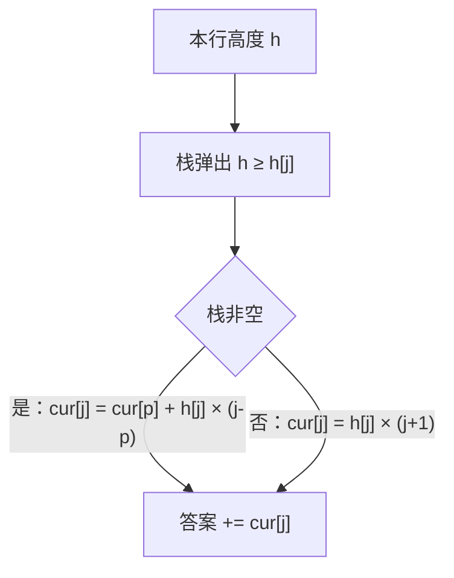

## Q
**LC 1504 统计全 1 子矩形**｜Medium

`0/1` 矩阵 `mat`，统计所有元素都是 `1` 的子矩形个数。

## A
**一句话。** 逐行累计每列连续 `1` 的高度；对这一行用单调栈，`cur[j]` 是右下角恰在 `(本行, j)` 的全 1 子矩形个数，所有 `cur[j]` 之和累加进答案。

**图解。** `cur[j] = cur[p] + h[j] * (j - p)`：`p` 是左边最近的更矮的列，`p` 左侧的矩形沿用 `cur[p]`，`(p, j]` 这一段每列高度都按 `h[j]` 贡献。



```python
def num_submat(mat):
    n = len(mat[0])
    h = [0] * n
    ans = 0
    for row in mat:
        for j in range(n):
            h[j] = h[j] + 1 if row[j] else 0   # 以本行为底的高度
        st, cur = [], [0] * n   # st：高度严格递增的列下标
        for j in range(n):
            while st and h[st[-1]] >= h[j]:
                st.pop()
            if st:
                p = st[-1]               # 左边最近的更矮的列
                cur[j] = cur[p] + h[j] * (j - p)
            else:
                cur[j] = h[j] * (j + 1)
            st.append(j)
            ans += cur[j]
    return ans
```

**复杂度。** 时间 `O(mn)`，空间 `O(n)`。

**易错点。**
- 弹出条件写成 `>`：相等高度也要弹出，否则 `p` 的高度和 `h[j]` 相同，会重复计数。
- 没有更矮的列时漏掉左边全部：`cur[j] = h[j] * (j + 1)`，所有左端点都可用。
- 高度没重置：本行是 `0` 时要置 `0`，不能沿用上一行。

**追问。**
- 更直观的 `O(mn·m)` 写法？：对每行、每个右端点往上扩展，维护向左延伸的最小宽度，求和。
- 和最大矩形（LC 85）的关系？：同样的「逐行高度 + 单调栈」，只是把求最大面积换成计数。

**同模式。** LC 85 最大矩形、LC 84 柱状图中最大的矩形、LC 221 最大正方形
