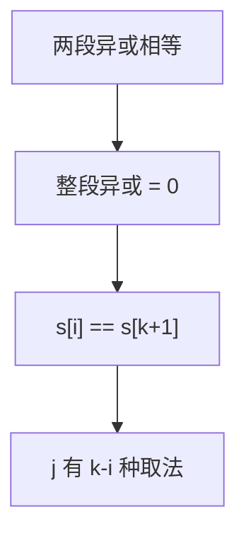

## Q
**LC 1442 形成两个异或相等数组的三元组数目**｜Medium

整数数组 `arr`，统计下标三元组 `(i, j, k)`（`0 ≤ i < j ≤ k < n`）的个数，使 `arr[i..j-1]` 的异或等于 `arr[j..k]` 的异或。

## A
**一句话。** 两段异或相等等价于 `arr[i..k]` 整段异或为 `0`，即前缀异或 `s[i] == s[k+1]`；这时 `j` 在 `i+1..k` 任取，共 `k - i` 个。

**图解。** 两段异或相等 `a = b` 等价于 `a ^ b = 0`，即整段异或为 `0`；整段为 `0` 时，切点 `j` 放哪里都行。



```python
def count_triplets(arr):
    s = [0] + list(accumulate(arr, lambda a, b: a ^ b))
    ans = 0
    for i in range(len(s)):
        for k in range(i + 2, len(s)):   # s[k]：arr 前 k 个的异或
            if s[i] == s[k]:
                ans += k - i - 1         # j 可取 i+1 .. k-1
    return ans
```

**复杂度。** 时间 `O(n²)`，空间 `O(n)`。

**易错点。**
- 枚举 `j` 再比较两段：`O(n³)`；整段异或为 `0` 时 `j` 任意，不用枚举。
- `j` 的个数数错：这里 `s` 的下标是 `i` 到 `k`（前缀数组下标），`j` 有 `k - i - 1` 种，对应 `arr` 下标 `k - i`。
- 前缀数组少一位：`s[0] = 0` 表示空前缀，必不可少。

**追问。**
- 能 `O(n)` 吗？：用哈希表记录每个前缀异或值出现的次数和下标之和，一次遍历累加贡献。
- 为什么异或相等能变成「整段为 0」？：`x ^ x = 0`，`a = b` 当且仅当 `a ^ b = 0`。

**同模式。** LC 560 和为 K 的子数组、LC 974 和可被 K 整除的子数组
