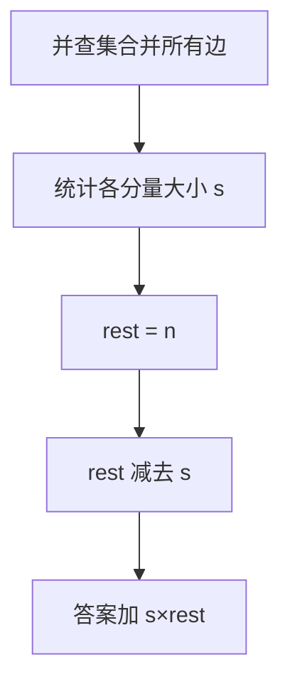

## Q
**LC 2316 统计无向图中无法互相到达点对数**｜Medium

`n` 个点的无向图（编号 `0` 到 `n-1`）和边列表。求无法互相到达的点对数目。

## A
**一句话。** 并查集求每个连通分量的大小 `s`；用 `rest` 表示还没处理的点数，每个分量贡献 `s × (rest - s)`。



```python
def count_pairs(n, edges):
    fa = list(range(n))

    def find(x):
        while fa[x] != x:
            fa[x] = fa[fa[x]]
            x = fa[x]
        return x

    for u, v in edges:
        fa[find(u)] = find(v)
    size = Counter(find(i) for i in range(n))
    ans, rest = 0, n
    for s in size.values():
        rest -= s                      # 之后的分量与它互相不可达
        ans += s * rest
    return ans
```

**复杂度。** 时间 `O(n α(n))`，空间 `O(n)`。

**易错点。**
- 每个分量都乘 `n - s`：每对会被数两次，用 `rest` 递减可以只数一次。
- 路径压缩后忘了再 `find`：`fa[i]` 不一定是根，统计分量要用 `find(i)`。

**追问。**
- 用 DFS 可以吗？：可以，每次 DFS 数出分量大小，思路一样。

**同模式。** LC 547 省份数量、LC 323 无向图中连通分量的数目、LC 990 等式方程的可满足性
