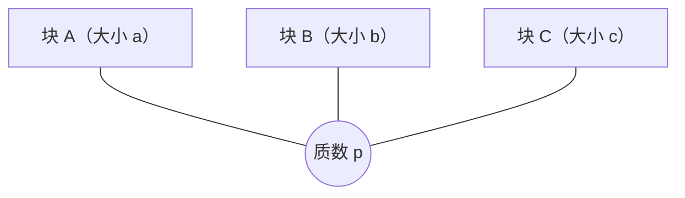

## Q
**LC 2867 统计树中的合法路径数目**｜Hard

结点标号 `1..n` 的无向树（`n <= 10^5`）。路径上恰好有一个标号是质数的路径叫合法路径。求合法路径的数目（`(a, b)` 与 `(b, a)` 算同一条）。

## A
**一句话。** 把非质数结点用并查集合并成连通块；每个质数结点把相邻的若干块和自己串起来，以它为唯一质数的路径，一端是它、一端在块里，或两端在不同的块里。

**图解。** 质数结点把几个非质数的块连在一起，路径只能经过它一次。



```python
def count_paths(n, edges):
    prime = [False, False] + [True] * (n - 1)
    for i in range(2, n + 1):          # 埃氏筛
        if prime[i]:
            for j in range(i * i, n + 1, i):
                prime[j] = False
    fa = list(range(n + 1))
    size = [1] * (n + 1)

    def find(x):
        while fa[x] != x:
            fa[x] = fa[fa[x]]          # 路径减半
            x = fa[x]
        return x

    g = [[] for _ in range(n + 1)]
    for a, b in edges:
        g[a].append(b)
        g[b].append(a)
        if not prime[a] and not prime[b]:   # 非质数合成一块
            ra, rb = find(a), find(b)
            if ra != rb:
                fa[ra] = rb
                size[rb] += size[ra]

    ans = 0
    for p in range(2, n + 1):
        if not prime[p]:
            continue
        acc = 1                        # p 自己作为一端
        for v in g[p]:
            if not prime[v]:
                s = size[find(v)]
                ans += acc * s         # 与已处理的块、p 本身配对
                acc += s
    return ans
```

**复杂度。** 时间 `O(n α(n))`（筛 `O(n log log n)`），空间 `O(n)`。

**易错点。**
- 把 `p` 到块内某点和块与块两种路径分开算：用 `acc` 初值 1 一次算完，`acc * s` 同时包含 `p` 自己与之前各块。
- 并查集也合并带质数的边：质数结点必须留在块外，否则路径里会有两个质数。

**追问。**
- 为什么两个块里取点的路径一定经过 `p`？：块之间只靠 `p` 相连，树上两点间只有一条路径。
- 不用并查集怎么做？：DFS 换根，对每个结点维护子树中「到它路径上无质数 / 恰有一个质数」的点数。

**同模式。** LC 547 省份数量、LC 3067 在带权树网络中统计可连接服务器对数目、LC 543 二叉树的直径
