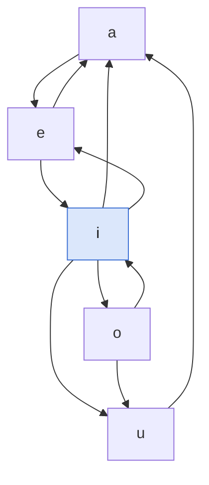

## Q
**LC 1220 统计元音字母序列的数目**｜Hard

长度为 `n` 的字符串只含小写元音，且满足：`a` 后只能是 `e`；`e` 后只能是 `a` 或 `i`；`i` 后不能是 `i`；`o` 后只能是 `i` 或 `u`；`u` 后只能是 `a`。求这样的字符串个数，对 `10^9 + 7` 取模。

## A
**一句话。** 状态是「以哪个元音结尾」，每加一个字符，新的结尾字母的方案数来自所有允许接在它前面的字母。

**图解。** 箭头是允许的相邻关系，每个字母的新方案数等于所有指向它的字母的旧方案数之和。



```python
def count_vowel_permutation(n):
    MOD = 10 ** 9 + 7
    a = e = i = o = u = 1         # 长度为 1：每个元音一种
    for _ in range(n - 1):
        a, e, i, o, u = ((e + i + u) % MOD,   # 谁后面能接 a
                         (a + i) % MOD,       # 接 e
                         (e + o) % MOD,       # 接 i
                         i,                   # 接 o
                         (i + o) % MOD)       # 接 u
    return (a + e + i + o + u) % MOD
```

**复杂度。** 时间 `O(n)`，空间 `O(1)`。

**易错点。**
- 方向写反：转移要列「谁后面能接我」，而不是「我后面能接谁」；两者互为转置，写反会得到错误的数。
- 少取模：每一项都要取模，否则大整数在其他语言里溢出。
- 漏掉 `i` 的转移：`i` 后面能接除自己外的四个元音，所以 `a`、`e`、`o`、`u` 的新值里都含 `i` 的旧值。

**追问。**
- 更快的做法？：5×5 转移矩阵快速幂，`O(log n)`。
- 规则表要变怎么办？：把规则放进邻接表，转移写成「对每个允许的前驱求和」。

**同模式。** LC 935 骑士拨号器、LC 1137 第 N 个泰波那契数、LC 70 爬楼梯
