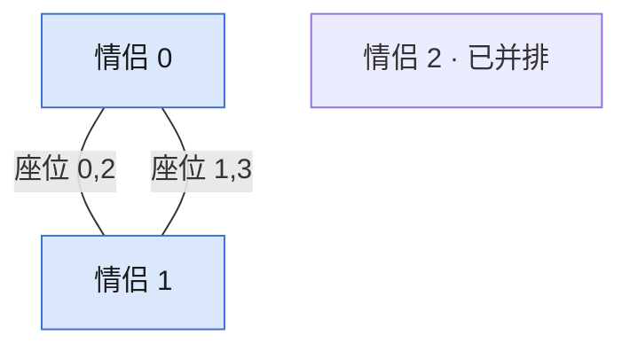

## Q
**LC 765 情侣牵手**｜Hard

`2n` 个人坐成一排，编号 `2k` 和 `2k + 1` 是一对情侣。每次可以让任意两人交换座位，求让每对情侣并排坐（座位 `2i`、`2i + 1` 是同一对）的最少交换次数。

## A
**一句话。** 把每对情侣当作一个结点，每个座位对把坐在一起的两对情侣连起来；一个含 `k` 对情侣的连通块需要 `k - 1` 次交换，答案是 `n` 减去连通块数。

**图解。** 排 `[0,2,1,3,4,5]`：座位对 `(0,2)` 和 `(1,3)` 都把情侣 0 和情侣 1 连在一起，这一块 2 对情侣要 1 次交换；情侣 2 已并排，自成一块。



```python
def min_swaps_couples(row):
    n = len(row) // 2
    fa = list(range(n))
    def find(x):
        while fa[x] != x:
            fa[x] = fa[fa[x]]    # 路径压缩
            x = fa[x]
        return x
    for i in range(0, 2 * n, 2):  # 每个座位对连起两对情侣
        fa[find(row[i] // 2)] = find(row[i + 1] // 2)
    return n - sum(find(i) == i for i in range(n))
```

**复杂度。** 时间 `O(n α(n))`，空间 `O(n)`。

**易错点。**
- 按人编号建并查集：结点是情侣（`编号 // 2`），不是人。
- 答案取连通块数：应是 `n - 块数`，每块的 `k` 对情侣要 `k - 1` 次。

**追问。**
- 为什么一块恰好 `k - 1` 次？：每次交换能让一个环里恰好一对情侣归位并把环缩短 1，`k` 对的环缩到 1 对（已并排）要 `k - 1` 步。
- 贪心怎么做？：从左到右看每个座位对，若不是情侣就把右边那位换成左边那位的伴侣，同样得到最少次数。

**同模式。** LC 684 冗余连接（Redundant Connection）、LC 947 移除最多的同行或同列石头、LC 547 省份数量、LC 721 账户合并
