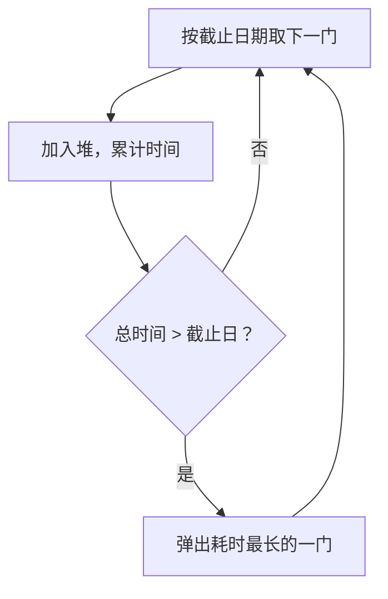

## Q
**LC 630 课程表 III**｜Hard

`courses[i] = [duration, lastDay]`：课程要连续上 `duration` 天，必须在第 `lastDay` 天结束前上完。从第 1 天开始，一次只能上一门，求最多能上多少门。

## A
**一句话。** 按截止日期排序，依次尝试加入；加入后若总时间超过当前截止日，就从已选课程中扔掉耗时最长的一门（用大顶堆）。

**图解。** 每门课都先放进去，超时了再退掉最长的那门，已选集合的总时间始终不超过当前截止日。



```python
def schedule_course(courses):
    courses.sort(key=lambda c: c[1])     # 按截止日期
    h, t = [], 0                         # 大顶堆(负数)，已选总时间
    for d, last in courses:
        heappush(h, -d)
        t += d
        if t > last:                     # 超时：扔掉最长的一门
            t += heappop(h)              # 弹出的是 -最大时长
    return len(h)
```

**复杂度。** 时间 `O(n log n)`，空间 `O(n)`。

**易错点。**
- 按开始时间或时长排序：贪心的前提是按截止日期，早截止的先考虑。
- 超时就丢掉当前这门：应丢耗时最长的那门，哪怕它不是当前的，这样总时间减少最多而课程数不变。
- 堆里存正数：Python 是小顶堆，存负数才能取最大。

**追问。**
- 为什么丢最长的不影响之前的可行性？：丢掉一门使总时间变短，之前每门课的完成时间只会提前，仍然满足各自的截止日。
- 想知道具体选了哪些课？：堆里存 `(-时长, 下标)`，最后堆中剩下的就是被选中的课。

**同模式。** LC 253 会议室 II、LC 1353 最多可以参加的会议数目、LC 871 最低加油次数、LC 435 无重叠区间
