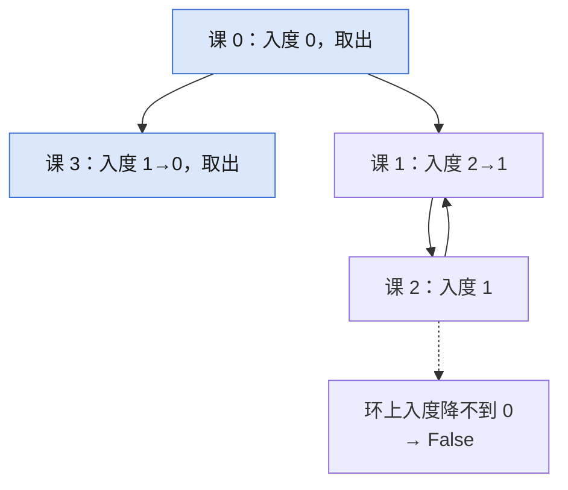

## Q
**LC 207 课程表**｜Medium

`numCourses` 门课，`prerequisites[i] = [a, b]` 表示学 `a` 前必须先学 `b`。判断能否学完所有课。

## A
**一句话。** 先修关系建有向图，Kahn 拓扑排序反复取入度为 0 的点，取出数等于总数才无环。

**图解。** 入度为 0 的课先被取出；环上的课入度永远降不到 0，取出数不足。



```python
def can_finish(num_courses, prerequisites):
    graph = [[] for _ in range(num_courses)]
    indegree = [0] * num_courses
    for course, pre in prerequisites:
        graph[pre].append(course)    # 先修课指向后修课
        indegree[course] += 1
    queue = deque(i for i in range(num_courses)
                  if indegree[i] == 0)
    taken = 0
    while queue:
        cur = queue.popleft()
        taken += 1
        for nxt in graph[cur]:
            indegree[nxt] -= 1
            if indegree[nxt] == 0:
                queue.append(nxt)
    return taken == num_courses      # 环上的点入度降不到 0
```

**复杂度。** 时间 `O(V+E)`，空间 `O(V+E)`。

**易错点。**
- DFS 判环只用一个 `visited`：菱形图 `4, [[1,0],[2,0],[3,1],[3,2]]` 被误判有环，需区分「在当前路径」与「已完成」。
- 邻接表写成 `[[]] * n`：所有节点共享同一个列表。

**追问。**
- 最少几个学期学完？：Kahn 按层处理，层数就是学期数，有环返回 `-1`。

**同模式。** LC 210 课程表 II、LC 1136 并行课程、LC 269 火星词典、LC 802 找到最终的安全状态
