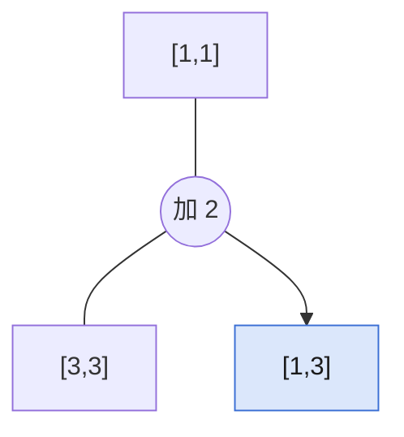

## Q
**LC 352 将数据流变为多个不相交区间**｜Hard

数据流里的非负整数陆续到来。设计 `SummaryRanges`：`addNum(value)` 加入一个数，`getIntervals()` 返回当前所有数汇总成的、按起点排序的不相交区间 `[start, end]`。

## A
**一句话。** 维护有序的不相交区间列表；新数用二分找到插入位置，看能否并到左邻区间、右邻区间，或两边都并，否则单独成一个区间。

**图解。** 已有 `[1,1]`、`[3,3]`，加入 `2`：左右都接得上，合并成 `[1,3]`。



```python
class SummaryRanges:
    def __init__(self):
        self.iv = []                   # 有序、不相交的区间

    def addNum(self, value):
        iv = self.iv
        i = bisect_left(iv, [value])   # 第一个起点 >= value
        if i and iv[i - 1][1] >= value:
            return                     # 已被左边区间盖住
        if i < len(iv) and iv[i][0] == value:
            return                     # 恰是右边区间的起点
        left = i > 0 and iv[i - 1][1] == value - 1
        right = i < len(iv) and iv[i][0] == value + 1
        if left and right:             # 两边都接上：合并
            iv[i - 1][1] = iv[i][1]
            iv.pop(i)
        elif left:
            iv[i - 1][1] = value
        elif right:
            iv[i][0] = value
        else:
            iv.insert(i, [value, value])

    def getIntervals(self):
        return self.iv
```

**复杂度。** 时间 `addNum` 为 `O(n)`（列表插入），`getIntervals` 为 `O(1)`，空间 `O(n)`。

**易错点。**
- 重复的数：已被某区间盖住时要直接返回，否则会插入错误的区间。
- 只检查左邻或右邻：一个数可能同时接上两边，要合并成一个。
- 用 `bisect_left(iv, value)`：列表元素是区间，要用 `[value]` 作比较键，或另存起点列表。

**追问。**
- 想让 `addNum` 也 `O(log n)`？：用平衡树或有序容器（`SortedDict`）存「起点到终点」，删除和插入都是对数级。
- 数值范围很小呢？：用并查集，每个数指向区间右端，`getIntervals` 再扫一遍。

**同模式。** LC 228 汇总区间、LC 163 缺失的区间、LC 57 插入区间、LC 56 合并区间
