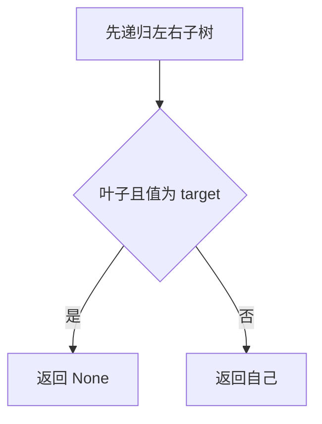

## Q
**LC 1325 删除给定值的叶子节点**｜Medium

给二叉树 `root` 和整数 `target`，删除所有值为 `target` 的叶子结点。删除后父结点若变成值为 `target` 的叶子，也要继续删，直到不能删为止。

## A
**一句话。** 后序遍历：先处理左右子树，再看自己是否因此变成了值为 `target` 的叶子，是就返回空。

**图解。** 树 `1 → 2 → 2`（`target = 2`）：最底层的叶子 `2` 先删，它的父结点 `2` 随之变成叶子，也被删，只剩根 `1`。



```python
def remove_leaf_nodes(root, target):
    if not root:
        return None
    root.left = remove_leaf_nodes(root.left, target)
    root.right = remove_leaf_nodes(root.right, target)
    leaf = not root.left and not root.right
    if leaf and root.val == target:
        return None                  # 子树删完，自己成叶子也要删
    return root
```

**复杂度。** 时间 `O(n)`，空间 `O(h)`。

**易错点。**
- 先序判断：先看自己是不是目标叶子，子树删除后父结点才变成叶子的情况会漏掉，必须后序。
- 忘了把递归结果接回孩子指针：删除靠返回 `None` 并赋给父结点的 `left` / `right`。
- 只检查值不检查叶子：必须左右孩子都为空才算叶子。

**追问。**
- 迭代怎么做？：后序栈遍历并记录父结点，或反复扫描删除，后者最坏 `O(n·h)`。
- 与「找树的叶子」（LC 366）相比？：都靠后序，让孩子先于父亲被处理。

**同模式。** LC 366 寻找二叉树的叶子节点、LC 450 删除二叉搜索树中的节点
