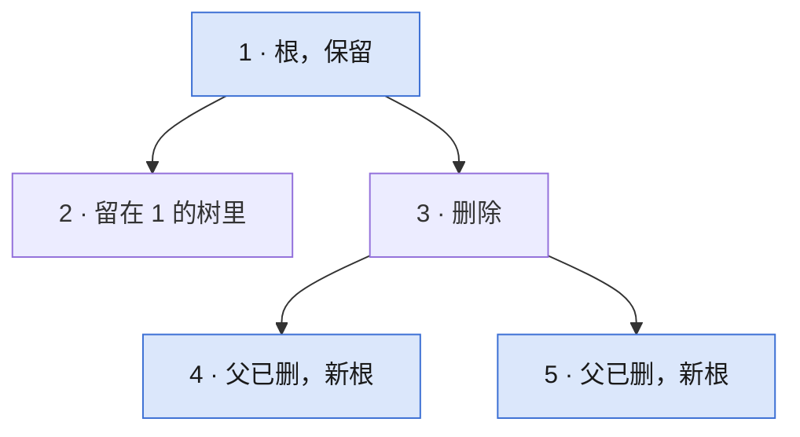

## Q
**LC 1110 删点成林**｜Medium

二叉树结点值互不相同，给定要删除的值列表 `to_delete`。删掉这些结点后树变成森林，返回森林中每棵树的根（顺序任意）。

## A
**一句话。** 自顶向下传「父结点是否被删」：父被删且自己没被删，自己就是新树的根；每层返回 `None` 或自己，把被删结点从父指针上摘掉。

**图解。** 删 `3`：它被摘掉后，没被删的孩子 `4`、`5` 的父亲已删，各自成为新树的根，加上原来的根 `1`，共三棵树。



```python
def del_nodes(root, to_delete):
    gone, res = set(to_delete), []
    def dfs(node, is_root):
        if not node:
            return None
        deleted = node.val in gone
        if is_root and not deleted:
            res.append(node)          # 父已删（或没有父）
        node.left = dfs(node.left, deleted)
        node.right = dfs(node.right, deleted)
        return None if deleted else node
    dfs(root, True)
    return res
```

**复杂度。** 时间 `O(n)`，空间 `O(n)`（`gone` 和递归栈）。

**易错点。**
- 被删结点的孩子忘了判「是否根」：它们没被摘掉也没成根，森林少树。
- `to_delete` 用列表查找：每个结点 `O(k)`，要先转成集合。
- 根本身被删：`is_root` 初值为真，但 `deleted` 时不加入结果。

**追问。**
- 为什么要后序返回而不是前序摘？：孩子要先处理完才能决定自己是否被摘，返回值正好把摘除接回父指针。
- 值有重复怎么办？：改用结点引用放进集合，或在遍历中按位置判断。

**同模式。** LC 1325 删除给定值的叶子节点、LC 2196 根据描述创建二叉树、LC 450 删除二叉搜索树中的节点
