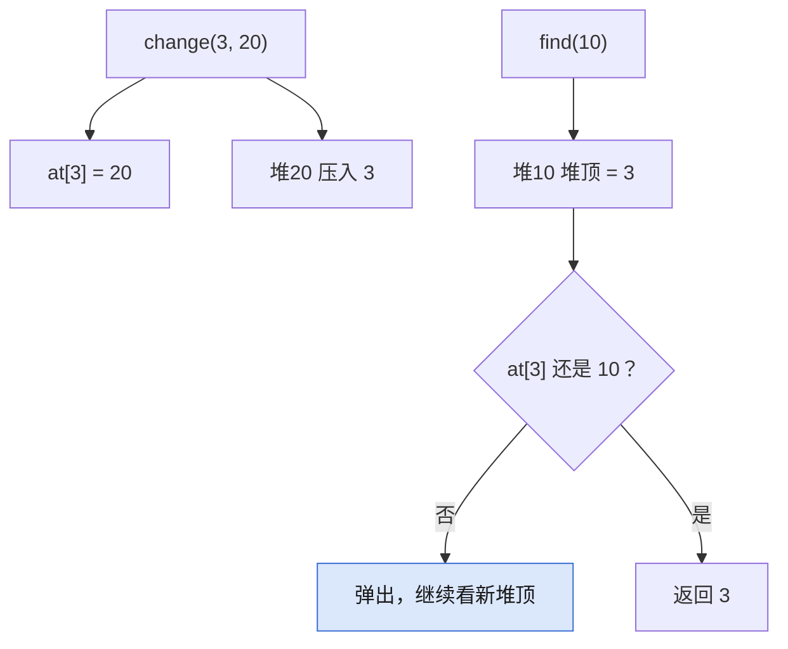

## Q
**LC 2349 设计数字容器系统**｜Medium

`change(index, number)` 把下标 `index` 处的数填成 `number`（可覆盖旧值）；`find(number)` 返回装着 `number` 的最小下标，没有返回 `-1`。

## A
**一句话。** 每个数字一个最小堆装它出现过的下标；覆盖时不立刻从旧堆里删，`find` 时再弹掉过期的堆顶（懒删除）。

**图解。** 下标 `3` 先放 `10` 再改成 `20`：`10` 的堆里还留着 `3`，下次 `find(10)` 看到 `at[3] != 10` 才丢掉。



```python
class NumberContainers:
    def __init__(self):
        self.at = {}                    # 下标 -> 当前数字
        self.heaps = defaultdict(list)  # 数字 -> 下标最小堆

    def change(self, index, number):
        self.at[index] = number
        heappush(self.heaps[number], index)  # 旧堆不动

    def find(self, number):
        h = self.heaps[number]
        while h and self.at[h[0]] != number:
            heappop(h)                  # 堆顶已被覆盖，丢掉
        return h[0] if h else -1
```

**复杂度。** `change` 为 `O(log n)`，`find` 摊还 `O(log n)`，空间 `O(n)`。

**易错点。**
- 只比较「下标是否在堆里」：同一个数字被改走又改回来时，堆里会有重复下标，要靠 `at` 校验当前值。
- 在 `change` 里线性删旧堆：`O(n)`，懒删除才是对数级。

**追问。**
- 为什么摊还是对数？：每个下标每次被压入最多被弹出一次，总弹出次数不超过总压入次数。
- 要支持最大下标呢？：再给每个数字配一个最大堆，或改用有序集合。

**同模式。** LC 3408 设计任务管理器、LC 2034 股票价格波动、LC 355 设计推特、LC 2502 设计内存分配器
