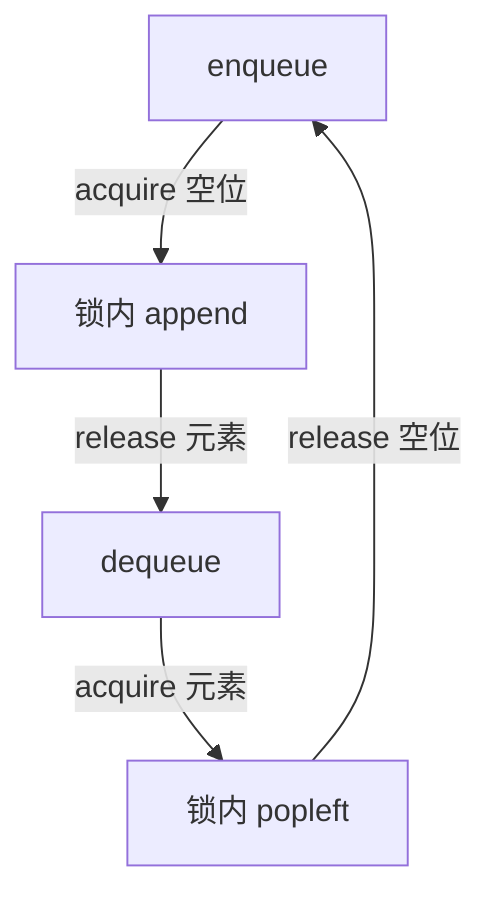

## Q
**LC 1188 设计有限阻塞队列**｜Medium

实现容量固定的线程安全队列 `BoundedBlockingQueue(capacity)`：`enqueue(x)` 队满时阻塞，`dequeue()` 队空时阻塞并返回队首，`size()` 返回当前元素数。

## A
**一句话。** 生产者消费者：用两个信号量分别计「空位」和「元素」，加一把锁保护底层队列。

**图解。** `enqueue` 先拿空位再放元素、再放出一个元素许可；`dequeue` 对称。信号量负责阻塞，锁只保护 deque 的修改。



```python
class BoundedBlockingQueue:
    def __init__(self, capacity):
        self.q = deque()
        self.empty = threading.Semaphore(capacity)  # 空位数
        self.full = threading.Semaphore(0)          # 元素数
        self.lock = threading.Lock()

    def enqueue(self, element):
        self.empty.acquire()         # 没空位就阻塞
        with self.lock:
            self.q.append(element)
        self.full.release()          # 通知消费者

    def dequeue(self):
        self.full.acquire()          # 没元素就阻塞
        with self.lock:
            x = self.q.popleft()
        self.empty.release()         # 腾出一个空位
        return x

    def size(self):
        return len(self.q)
```

**复杂度。** 时间 每次操作 `O(1)`，空间 `O(capacity)`。

**易错点。**
- 只用一把锁和轮询：忙等占 CPU；用信号量让线程睡眠，由对方唤醒。
- 在持锁时阻塞：先拿到锁再等空位，消费者拿不到锁，永远没人释放空位，死锁，所以先 `acquire` 信号量再拿锁。
- 只有一个信号量：必须有两个，分别约束「不超过容量」和「不低于零」。

**追问。**
- 用条件变量怎么写？：一把锁两个 `Condition`（非空、非满），`while` 里 `wait`，修改后 `notify`。
- 为什么 `wait` 要放在 `while` 里？：被唤醒时条件可能已被别的线程改掉，要再检查一次。

**同模式。** LC 1114 按序打印、LC 1226 哲学家进餐
