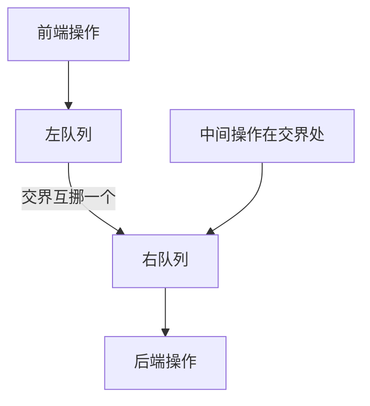

## Q
**LC 1670 设计前中后队列**｜Medium

设计队列，支持 `pushFront`、`pushMiddle`、`pushBack`、`popFront`、`popMiddle`、`popBack`。有两个中间位置时取靠前的那个：长度 `n` 时 `pushMiddle` 插到下标 `n // 2`，`popMiddle` 弹出下标 `(n - 1) // 2`；队列为空时弹出返回 `-1`。

## A
**一句话。** 用左右两个双端队列，保证 `len(l) <= len(r) <= len(l) + 1`，中间位置永远在两队列交界处，每次操作后把多的一个挪过去。



```python
class FrontMiddleBackQueue:
    def __init__(self):
        self.l = deque()
        self.r = deque()   # 保持 len(l) <= len(r) <= len(l)+1

    def _fix(self):
        while len(self.l) > len(self.r):
            self.r.appendleft(self.l.pop())
        while len(self.r) > len(self.l) + 1:
            self.l.append(self.r.popleft())

    def pushFront(self, val):
        self.l.appendleft(val)
        self._fix()

    def pushMiddle(self, val):
        self.r.appendleft(val)       # 下标 n//2 恰是 r 的头
        self._fix()

    def pushBack(self, val):
        self.r.append(val)
        self._fix()

    def popFront(self):
        if not self.r:
            return -1
        v = (self.l or self.r).popleft()
        self._fix()
        return v

    def popMiddle(self):
        if not self.r:
            return -1
        v = self.l.pop() if len(self.l) == len(self.r) \
            else self.r.popleft()
        self._fix()
        return v

    def popBack(self):
        if not self.r:
            return -1
        v = self.r.pop()
        self._fix()
        return v
```

**复杂度。** 每个操作均摊 `O(1)`，空间 `O(n)`。

**易错点。**
- 只用一个列表：`pushFront`、`pushMiddle` 是 `O(n)`，调用多了会超时。
- `popFront` 在 `l` 为空时：此时 `r` 至多一个元素，要从 `r` 头弹。
- 偶数长度的中间位：`popMiddle` 弹的是靠前的那个，即 `l` 的尾。

**追问。**
- 为什么让 `r` 比 `l` 多一个而不是反过来？：中间下标 `n // 2` 恰在 `r` 头，`pushMiddle` 一步到位。

**同模式。** LC 641 设计循环双端队列、LC 622 设计循环队列、LC 346 数据流中的移动平均值、LC 1472 设计浏览器历史记录
