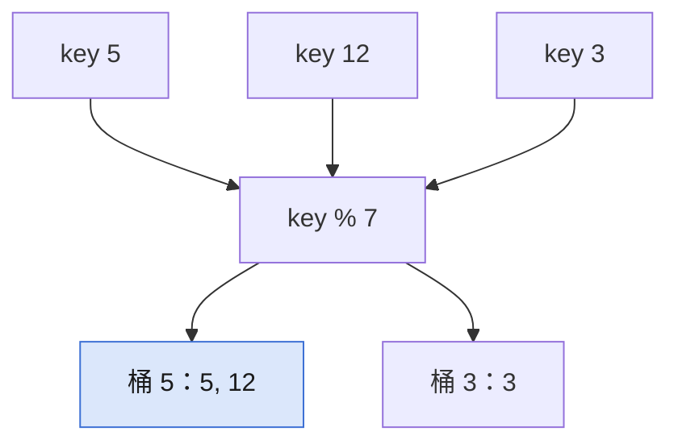

## Q
**LC 705 设计哈希集合**｜Easy

不用内置哈希表，实现 `MyHashSet`：`add(key)`、`remove(key)`、`contains(key)`，键为 `0..10^6` 的整数。

## A
**一句话。** 取模把键分到固定数量的桶，桶内用小列表存放（链地址法，separate chaining）；三个操作都只碰一个桶。

**图解。** 键先取模定位桶，冲突的键串在同一个桶里。



```python
class MyHashSet:
    def __init__(self):
        self.m = 1009                 # 质数个桶，冲突更均匀
        self.buckets = [[] for _ in range(self.m)]

    def add(self, key):
        b = self.buckets[key % self.m]
        if key not in b:              # 集合不存重复键
            b.append(key)

    def remove(self, key):
        b = self.buckets[key % self.m]
        if key in b:
            b.remove(key)

    def contains(self, key):
        return key in self.buckets[key % self.m]
```

**复杂度。** 每个操作平均 `O(n / m)`，`m` 固定时可视为 `O(1)`；空间 `O(n + m)`。

**易错点。**
- `add` 不先查重：同一个键会在桶里出现多次，`remove` 一次删不干净。
- 桶用 `set` 或 `dict`：就等于用了内置哈希表，违背题意。

**追问。**
- 数据量大时桶会很长怎么办？：负载因子（元素数除以桶数）超过阈值就扩容并重新取模放入，保持均摊 `O(1)`。
- 为什么不开 `10^6` 大小的布尔数组？：键范围小时可以，但空间和键范围成正比，哈希表只与元素数成正比。

**同模式。** LC 706 设计哈希映射、LC 707 设计链表、LC 622 设计循环队列
