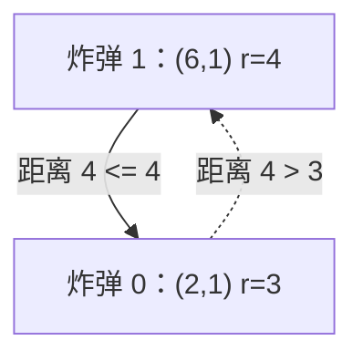

## Q
**LC 2101 引爆最多的炸弹**｜Medium

炸弹 `[x, y, r]`，引爆后范围内的炸弹连锁引爆。只能手动引爆一个，求最多能引爆几个。

## A
**一句话。** `i` 的圆覆盖 `j` 的圆心就连有向边 `i → j`，从每个点做一次 DFS，可达点数的最大值即答案。

**图解。** 半径不同使边有方向：`1` 能炸到 `0`，`0` 却够不着 `1`，所以从 `1` 出发得 2。



```python
def maximum_detonation(bombs):
    n = len(bombs)
    g = [[] for _ in range(n)]
    for i, (x, y, r) in enumerate(bombs):
        for j, (u, v, _) in enumerate(bombs):
            if i != j and (x-u)**2 + (y-v)**2 <= r*r:
                g[i].append(j)   # 有向边：i 能炸到 j

    def dfs(i, seen):
        seen.add(i)
        for j in g[i]:
            if j not in seen:
                dfs(j, seen)
        return len(seen)

    return max(dfs(i, set()) for i in range(n))
```

**复杂度。** 时间 `O(n³)`，空间 `O(n²)`。

**易错点。**
- 当成无向图用并查集：`i` 能炸 `j` 不代表 `j` 能炸 `i`，连通块会算多。
- 开方比较距离：浮点有误差，平方后用整数比较。

**追问。**
- `n` 很大时？：先求强连通分量缩点成 DAG，再在 DAG 上数可达点，但可达集合计数本身仍难降到线性。
- 为什么每个起点都要重搜？：有向图里可达集合互不包含，不能复用一次搜索的结果。

**同模式。** LC 200 岛屿数量、LC 547 省份数量、LC 841 钥匙和房间
