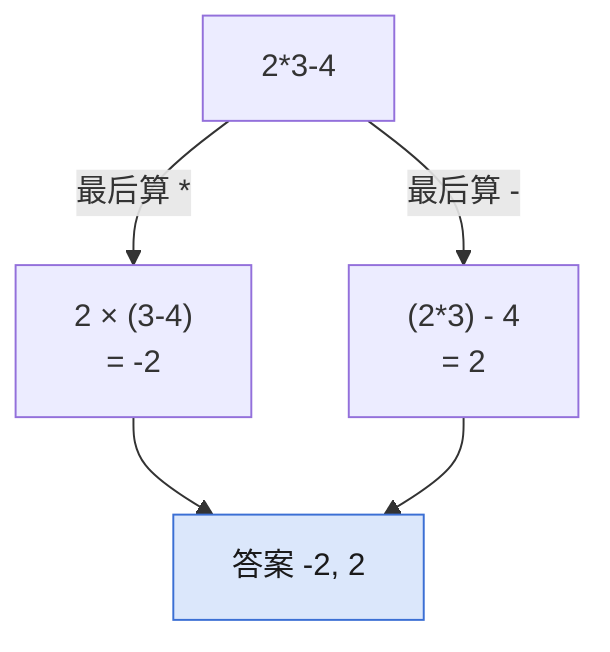

## Q
**LC 241 为运算表达式设计优先级**｜Medium

给只含数字和 `+ - *` 的字符串，任意加括号，返回所有可能的计算结果（可重复，顺序不限）。

## A
**一句话。** 枚举最后一个被计算的运算符，左右两段各自递归求出所有结果，再两两组合。

**图解。** 每个运算符都可能是最后一步，左右子表达式的结果集做笛卡尔积。



```python
def diff_ways_to_compute(expression):
    @cache                          # 同一子串只算一次
    def go(s):
        res = []
        for i, c in enumerate(s):
            if c in '+-*':          # 以它为最后一步
                for a in go(s[:i]):
                    for b in go(s[i + 1:]):
                        if c == '+':
                            res.append(a + b)
                        elif c == '-':
                            res.append(a - b)
                        else:
                            res.append(a * b)
        return tuple(res) if res else (int(s),)  # 纯数字
    return list(go(expression))
```

**复杂度。** 时间约卡特兰数级 `O(C_n)`，空间 `O(C_n)`（`n` 为运算符个数）。

**易错点。**
- 把数字按单个字符处理：`"10+5"` 会被切成 `1`、`0`，要在没有运算符时整段 `int`。
- 结果去重：题目要的是所有加括号方式的结果，相同值要保留多份。
- 缓存返回可变列表：之后被改会污染缓存，这里返回元组。

**追问。**
- 只要结果的个数怎么办？：同样的区间 DP，只记个数，不用展开结果。
- 为什么记忆化有用？：不同切法会反复算到同一个子串，缓存后每个子串只展开一次。

**同模式。** LC 95 不同的二叉搜索树 II、LC 282 给表达式添加运算符、LC 679 24 点游戏、LC 22 括号生成
