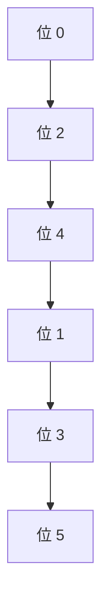

## Q
**LC 1054 距离相等的条形码**｜Medium

仓库里有一排条形码，第 `i` 个是 `barcodes[i]`。重新排列，使任意两个相邻的条形码不相等；保证答案存在。

## A
**一句话。** 按出现次数从多到少，依次往下标 `0, 2, 4, …` 填，填满偶数位后接着填 `1, 3, 5, …`。

**图解。** 次数最多的值占满偶数位，不会与自己相邻。



```python
def rearrange_barcodes(barcodes):
    cnt = Counter(barcodes)
    res = [0] * len(barcodes)
    i = 0
    for v, c in cnt.most_common():   # 次数多的先放
        for _ in range(c):
            res[i] = v
            i += 2                   # 隔一个放
            if i >= len(res):
                i = 1                # 偶数位放完转奇数位
    return res
```

**复杂度。** 时间 `O(n + k log k)`（`k` 为不同值个数），空间 `O(n)`。

**易错点。**
- 不排序直接按字典顺序填：次数最多的值若没占满偶数位，会在奇偶交界处与自己相邻。
- 偶数位放完后从 `0` 回绕：要从 `1` 开始，否则覆盖已放的元素。
- 想自己判断无解：题目保证有解，最大次数 ≤ `⌈n/2⌉`，所以最多的值恰好能占满偶数位。

**追问。**
- 不保证有解呢？：先看最大次数是否超过 `(n+1)//2`，超过就返回空。
- 用堆怎么做？：每次从堆里取次数最多且不同于上一个的值，`O(n log k)`，通用于 K 距离间隔。

**同模式。** LC 767 重构字符串、LC 358 K 距离间隔重排字符串、LC 1405 最长快乐字符串、LC 621 任务调度器
