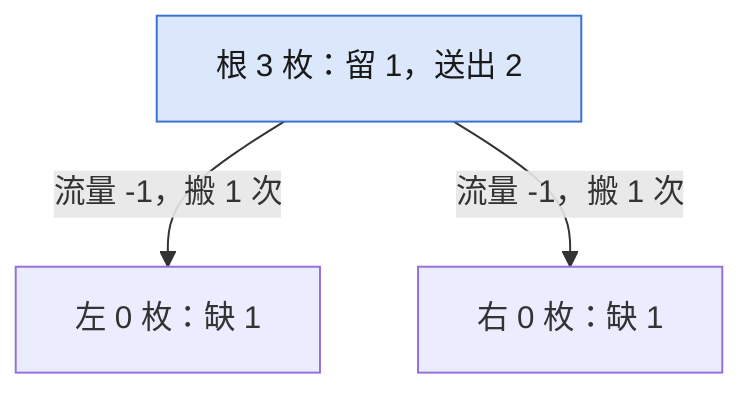

## Q
**LC 979 在二叉树中分配硬币**｜Medium

二叉树共 `n` 个节点，每个节点 `val` 枚硬币，总数恰为 `n`。每步可把一枚硬币移到相邻（父或子）节点，求使每个节点恰好一枚硬币的最少移动次数。

## A
**一句话。** 后序递归：每个节点向父亲「净流出」`val - 1 + 左流 + 右流` 枚（负数表示要流入），每条边至少要搬运 `|流量|` 次，累加所有边。

**图解。** 根有 3 枚，两个孩子各缺 1 枚：两条边各搬 1 次，共 2 步。



```python
def distribute_coins(root):
    ans = 0
    def dfs(node):                     # 经过 node 到父亲的净流量
        nonlocal ans
        if not node:
            return 0
        l, r = dfs(node.left), dfs(node.right)
        ans += abs(l) + abs(r)         # 孩子到 node 的边搬 |流量| 次
        return node.val - 1 + l + r    # 自己留 1，多的往上送
    dfs(root)
    return ans
```

**复杂度。** 时间 `O(n)`，空间 `O(h)`。

**易错点。**
- 把流量只当非负数：缺硬币时是负数，也要计入 `abs`，缺和多一样要搬。
- 在 `dfs` 里累加 `abs(返回值)` 且加两次：每条边只统计一次，在父节点处统计两条孩子边。
- 想模拟每一步移动：不需要，只关心每条边上的净流量。

**追问。**
- 为什么搬运次数就是 `|流量|`？：硬币沿边只需单向搬运，来回搬是浪费，所以净流量的绝对值就是下界，也能达到。
- 总数不是 `n` 怎么办？：无解，题目保证相等。

**同模式。** LC 968 监控二叉树、LC 2673 使二叉树所有路径值相等的最小代价、LC 124 二叉树中的最大路径和、LC 543 二叉树的直径
