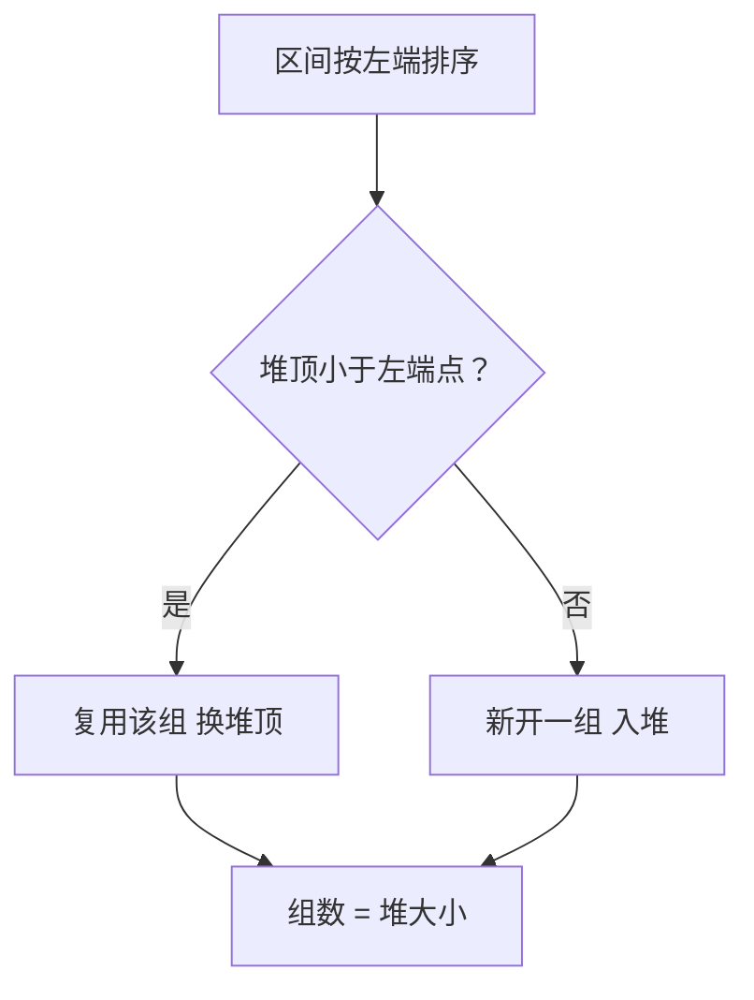

## Q
**LC 2406 将区间分为最少组数**｜Medium

区间数组 `intervals`，`[left, right]` 是闭区间。把所有区间分成若干组，同一组内任意两个区间不相交（端点相同也算相交）。求最少需要的组数。

## A
**一句话。** 最少组数就是同一时刻重叠区间数的最大值；按左端点排序，用小根堆存每组当前最右端点，能接在最小的最右端点之后就复用，否则新开一组。



```python
def min_groups(intervals):
    h = []                           # 每组当前的最右端点
    for left, right in sorted(intervals):
        if h and h[0] < left:        # 严格小于才不相交
            heapreplace(h, right)    # 接到这一组后面
        else:
            heappush(h, right)       # 新开一组
    return len(h)
```

**复杂度。** 时间 `O(n log n)`，空间 `O(n)`。

**易错点。**
- 比较写成 `h[0] <= left`：闭区间端点相同也算相交，必须严格小于。
- 只排序不用堆：只看上一个区间会漏掉其他组的更早结束者。

**追问。**
- 不用堆怎么做？：差分数组 / 扫描线，端点 `+1`、`right + 1` 处 `-1`，取前缀和最大值。

**同模式。** LC 253 会议室 II、LC 1834 单线程 CPU、LC 1882 使用服务器处理任务
