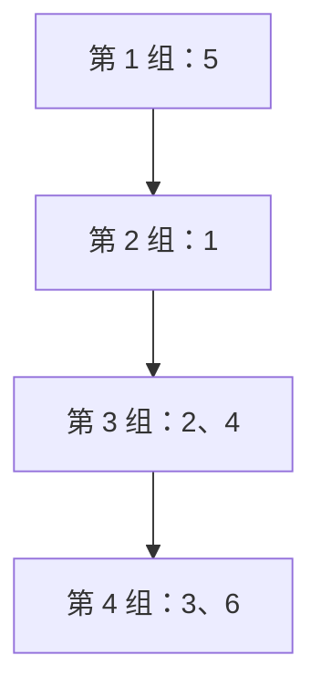

## Q
**LC 2493 将节点分成尽可能多的组**｜Hard

无向图（可能不连通）节点 `1..n`，把点分到编号从 1 开始的组里，每条边两端的组号差恰为 1。求最多分几组，做不到返回 `-1`。

## A
**一句话。** 组号差为 1 等价于二分图（有奇环就 `-1`）；每个连通块从每个点出发 BFS，层数的最大值就是这块最多的组数，各块相加。

**图解。** 示例从点 5 出发 BFS，每层就是一组，得 4 组；同层之间若有边就是奇环。



```python
def magnificent_sets(n, edges):
    g = [[] for _ in range(n + 1)]
    for a, b in edges:
        g[a].append(b)
        g[b].append(a)
    comp = [0] * (n + 1)
    def mark(u, c):              # DFS 给连通块编号
        comp[u] = c
        for v in g[u]:
            if not comp[v]:
                mark(v, c)
    for u in range(1, n + 1):
        if not comp[u]:
            mark(u, u)

    def layers(s):               # 从 s 出发的 BFS 层数
        dep = {s: 0}
        q = deque([s])
        while q:
            u = q.popleft()
            for v in g[u]:
                if v not in dep:
                    dep[v] = dep[u] + 1
                    q.append(v)
                elif dep[v] == dep[u]:
                    return -1    # 同层相连：奇环
        return max(dep.values()) + 1

    best = defaultdict(int)
    for s in range(1, n + 1):
        k = layers(s)
        if k < 0:
            return -1
        best[comp[s]] = max(best[comp[s]], k)
    return sum(best.values())
```

**复杂度。** 时间 `O(n·(n+m))`，空间 `O(n+m)`。

**易错点。**
- 整张图只从一个点 BFS：图可能不连通，每块要单独取最大再相加。
- 只从度数最小的点出发：最优起点不一定是它，要每个点都试。

**追问。**
- 为什么层数就是组数？：BFS 层号让每条边两端相差 1，而任意合法分组的组数不超过某个起点的离心率加 1。
- 为什么同层有边就无解？：从起点到这两点的两条最短路加上这条边构成奇环，二分图不允许。

**同模式。** LC 994 腐烂的橘子、LC 785 判断二分图、LC 886 可能的二分法
