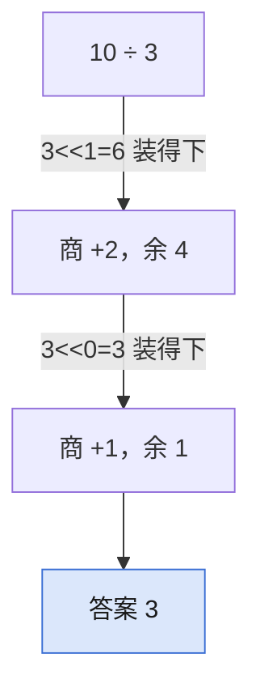

## Q
**LC 29 两数相除**｜Medium

不用乘、除和取模，计算 `dividend / divisor`，结果向零取整，超出 32 位有符号整数范围时按边界截断。

## A
**一句话。** 把商拆成二进制：从高位到低位试 `divisor·2^k` 是否还装得下被除数，装得下就减掉并给商加 `2^k`。

**图解。** `10 ÷ 3`：先试 `3·2`，余 `4`；再试 `3·1`，余 `1`；商 `2 + 1 = 3`。



```python
def divide(dividend, divisor):
    if dividend == -2**31 and divisor == -1:
        return 2**31 - 1             # 唯一会溢出的情形
    neg = (dividend < 0) != (divisor < 0)
    a, b = abs(dividend), abs(divisor)
    res = 0
    for k in range(31, -1, -1):      # 从高位试商
        if (a >> k) >= b:            # b·2^k <= a
            a -= b << k
            res += 1 << k
    return -res if neg else res
```

**复杂度。** 时间 `O(log dividend)`，空间 `O(1)`。

**易错点。**
- `-2³¹ / -1`：结果 `2³¹` 超出范围，必须单独返回 `2³¹-1`。
- 一次次减除数：被除数大除数小时是 `O(n)` 会超时，要倍增。
- 符号判断：用 `(a < 0) != (b < 0)`，别用乘法判断；负数先取绝对值再算。

**追问。**
- 为什么 `a >> k >= b` 与 `b << k <= a` 等价且更安全？：左移可能溢出（在固定宽度语言里），右移不会。
- 只能用 32 位整数怎么办？：先全部转成负数计算（负数范围更大），避免 `abs(-2³¹)` 溢出。

**同模式。** LC 50 Pow(x, n)、LC 372 超级次方、LC 69 x 的平方根、LC 371 两整数之和
