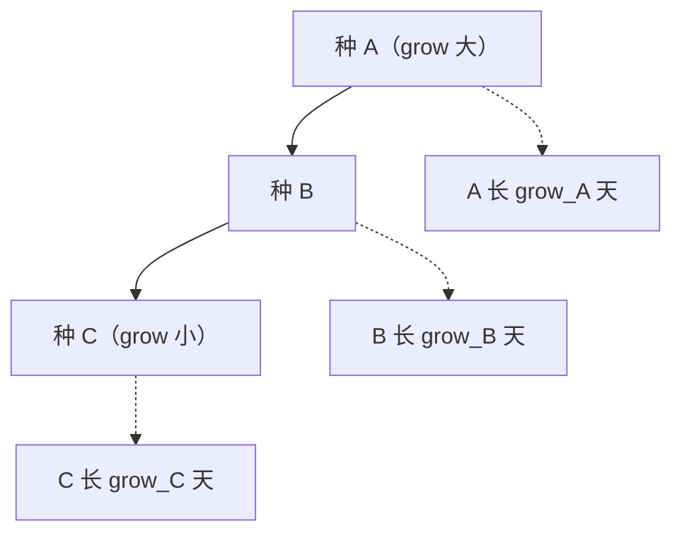

## Q
**LC 2136 全部开花的最早一天**｜Hard

有 `n` 颗种子，第 `i` 颗需要 `plantTime[i]` 个整天种下（每天只能种一颗，天数可不连续），种完后再过 `growTime[i]` 天开花。求所有种子都开花的最早一天。

## A
**一句话。** 种植只能串行，生长可以并行：先种生长时间长的，让它们尽早开始长；按 `growTime` 从大到小排序，累加种植时间，答案是各颗「种完时刻 + 生长时间」的最大值。

**图解。** 种植是一条串行的线，生长是挂在各自种完之后的并行尾巴；尾巴长的放前面，总长才最短。



```python
def earliest_full_bloom(plant_time, grow_time):
    t = ans = 0
    order = sorted(zip(plant_time, grow_time),
                   key=lambda x: -x[1])   # 生长久的先种
    for p, g in order:
        t += p                            # 这颗种完的时刻
        ans = max(ans, t + g)
    return ans
```

**复杂度。** 时间 `O(n log n)`，空间 `O(n)`。

**易错点。**
- 按种植时间排序：种得快的先种并不能让长得慢的更早开始长，应按生长时间。
- 把 `t + g` 累加起来：生长并行，答案是最大值而不是求和。

**追问。**
- 为什么交换相邻两颗可以证明最优？：相邻 `x, y` 若 `grow_x < grow_y`，先种 `y` 的完成时刻 `max(p_y+g_y, p_y+p_x+g_x)`，不超过先种 `x` 的 `max(p_x+g_x, p_x+p_y+g_y)`。
- 种植可以拆开不连续，会改变答案吗？：不会，拆开种只会让每颗的完成时刻更晚，整块连着种最优。

**同模式。** LC 1665 完成所有任务的最少初始能量、LC 630 课程表 III、LC 1029 两地调度
