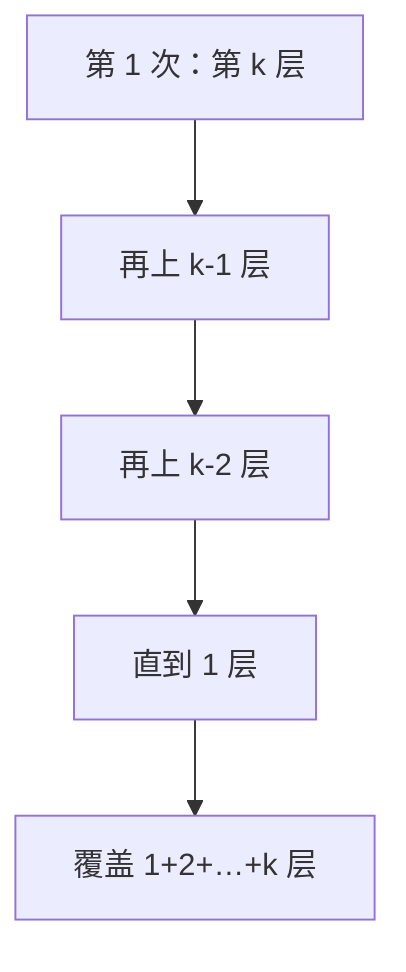

## Q
**LC 1884 鸡蛋掉落-两枚鸡蛋**｜Medium

有 `2` 枚相同的鸡蛋和一栋 `n` 层的楼。存在某层 `f`，从高于 `f` 的楼层扔蛋会碎，不高于 `f` 不会碎。求保证确定 `f` 的最少扔蛋次数（最坏情况）。

## A
**一句话。** 第一次从 `k` 层扔，碎了就用第二枚从下往上逐层试，最多再扔 `k-1` 次；不碎则再上 `k-1` 层……共覆盖 `k + (k-1) + … + 1 = k(k+1)/2` 层，取最小的 `k` 使它 `>= n`。



```python
def two_egg_drop(n):
    k = 0
    while k * (k + 1) // 2 < n:     # k 次最多能覆盖的层数
        k += 1
    return k
```

**复杂度。** 时间 `O(√n)`，空间 `O(1)`。

**易错点。**
- 每次间隔固定：间隔固定时最坏情况前松后紧，要让每多扔一次，间隔少一层，使各情形最坏次数相同。
- 套用二分：第一枚碎了之后第二枚只能从下往上逐层试，第一次不能取中点。

**追问。**
- `k` 枚蛋呢？：`dp[m][e]` 表示 `m` 次 `e` 枚蛋最多覆盖的层数，`dp[m][e] = dp[m-1][e-1] + dp[m-1][e] + 1`。

**同模式。** LC 887 鸡蛋掉落、LC 375 猜数字大小 II、LC 410 分割数组的最大值、LC 1140 石子游戏 II
