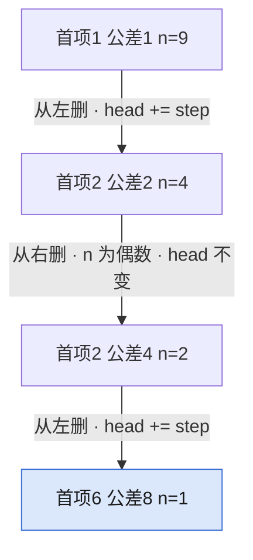

## Q
**LC 390 消除游戏**｜Medium

列表 `[1, 2, …, n]`。第一轮从左到右每隔一个数删一个（删第 1、3、5…个），第二轮从右到左同样操作，如此交替直到只剩一个数。返回最后剩下的数。

## A
**一句话。** 每轮剩下的数都是等差数列，只需维护首项 `head` 和公差 `step`：每轮元素减半、公差翻倍；首项在「从左删」或「剩下奇数个且从右删」时才会被删掉，要后移一个公差。

**图解。** 每一轮后数列长度减半、公差翻倍，首项只在被删掉的那两种情形下后移。



```python
def last_remaining(n):
    head, step, left = 1, 1, True
    while n > 1:
        if left or n % 2 == 1:   # 首项会被删掉
            head += step
        n //= 2
        step *= 2
        left = not left
    return head
```

**复杂度。** 时间 `O(log n)`，空间 `O(1)`。

**易错点。**
- 从右删且 `n` 是偶数时也把 `head` 后移：这种情形删的是最后一个、第一个保留，`head` 不变。
- 公差不翻倍：每轮删掉一半，相邻幸存者的距离变成两倍。
- 直接模拟：`n` 到 `10^9`，必须找规律。

**追问。**
- 为什么奇数个且从右删会删掉首项？：从右数起删第 1、3、5…，当个数为奇数时，从右数的最后一个删除的是最左的元素。
- 能写成递归吗？：设 `f(n)` 为从左删的答案，`g(n)` 从右删，则 `f(n) = 2 · g(n / 2)`、`g(n) = 2 · (n/2 + 1 - f(n/2))`，镜像关系。

**同模式。** LC 1823 找出游戏的获胜者、LC 292 Nim 游戏
