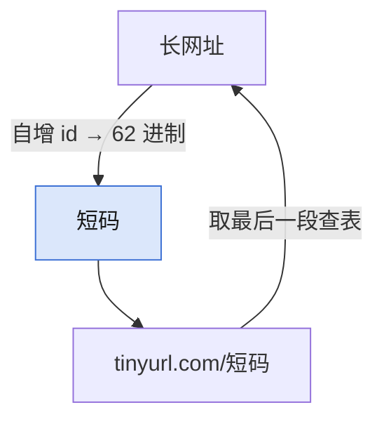

## Q
**LC 535 TinyURL 的加密与解密**｜Medium

设计短网址服务：`encode(longUrl)` 把长网址变成短网址，`decode(shortUrl)` 还原出原来的长网址，算法自定。

## A
**一句话。** 自增 id 转成 62 进制当短码，用哈希表存「短码到长网址」，解码时取 URL 最后一段查表。

**图解。** 编码和解码互为逆过程，中间靠一张表。



```python
CH = ('0123456789abcdefghijklm'
      'nopqrstuvwxyzABCDEFGHIJKLM'
      'NOPQRSTUVWXYZ')

class Codec:
    def __init__(self):
        self.db = {}                   # 短码 -> 长网址
        self.n = 0                     # 自增 id

    def encode(self, longUrl):
        self.n += 1
        code, x = '', self.n
        while x:
            x, r = divmod(x, 62)
            code = CH[r] + code        # 转成 62 进制
        self.db[code] = longUrl
        return 'http://tinyurl.com/' + code

    def decode(self, shortUrl):
        return self.db[shortUrl.rsplit('/', 1)[-1]]
```

**复杂度。** 时间每次 `O(log n)`，空间 `O(已编码网址总数)`。

**易错点。**
- 用随机码不检查冲突：两个长网址可能得到同一个短码，要么查重重试，要么用自增 id 保证唯一。
- 同一个长网址每次都新建一个短码：可以，但多占空间，想去重要再存一张「长到短」的表。
- id 转进制时 `x = 0`：从 1 开始自增，避免空串短码。

**追问。**
- 分布式怎么生成不重复的 id？：号段分配或雪花算法（时间戳、机器号、序列号），各节点独立生成。
- 短码长度够不够？：62 进制 7 位约 `3.5·10¹²` 个，通常足够；用哈希截断则要处理冲突。

**同模式。** LC 271 字符串的编码与解码、LC 297 二叉树的序列化与反序列化、LC 380 O(1) 时间插入、删除和获取随机元素、LC 146 LRU 缓存
