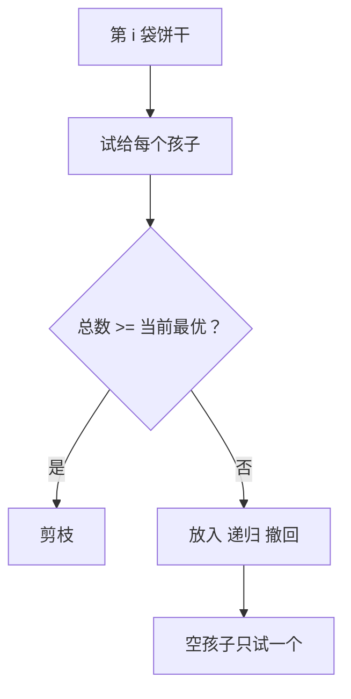

## Q
**LC 2305 公平分发饼干**｜Medium

整数数组 `cookies`，`cookies[i]` 是第 `i` 袋饼干的数量，要分给 `k` 个孩子，每袋只能整袋给一个孩子。一次分配的"不公平程度"是所有孩子各自饼干总数中的最大值。求最小的不公平程度。

## A
**一句话。** 回溯：每袋饼干依次试给每个孩子，维护各孩子总数；用当前最优值剪枝，并让"空孩子"只试第一个（它们互相对称）。



```python
def distribute_cookies(cookies, k):
    cookies.sort(reverse=True)         # 大的先分，剪枝更早生效
    load = [0] * k
    best = [inf]

    def dfs(i):
        if i == len(cookies):
            best[0] = min(best[0], max(load))
            return
        for j in range(k):
            if load[j] + cookies[i] >= best[0]:
                continue               # 已不可能更优
            load[j] += cookies[i]
            dfs(i + 1)
            load[j] -= cookies[i]
            if load[j] == 0:           # 之前的空孩子等价，只试一个
                break

    dfs(0)
    return best[0]
```

**复杂度。** 时间最坏 `O(k^n)`，剪枝后大大减少；空间 `O(n + k)`。

**易错点。**
- 没有对称剪枝：`k` 个空孩子会重复搜索同样的情形。
- 取 `max(load)` 在叶子才算：可以在每次放入时就用 `best` 剪掉，否则很慢。

**追问。**
- 想要多项式解法？：这是 NP-hard 的装箱类问题，实际用二分答案加回溯，或状压 DP `O(3^n)`。

**同模式。** LC 416 分割等和子集、LC 473 火柴拼正方形、LC 698 划分为k个相等的子集、LC 1723 完成所有工作的最短时间
