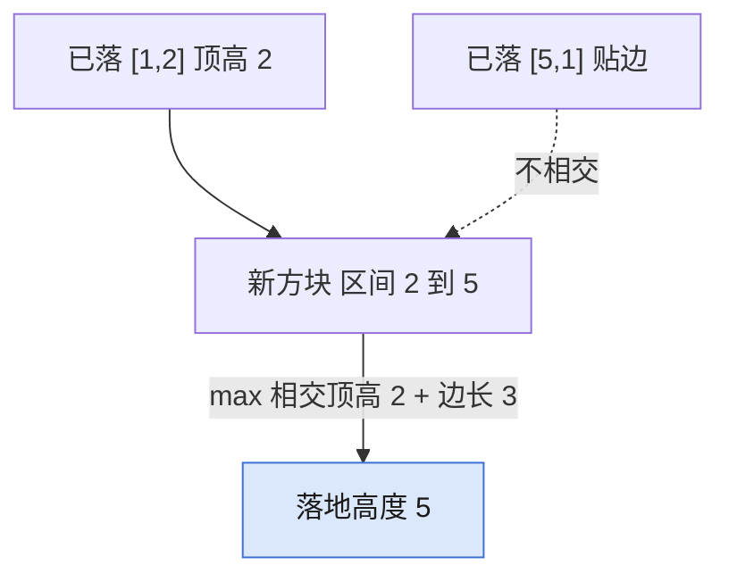

## Q
**LC 699 掉落的方块**｜Hard

`positions[i] = [left, side]` 表示按顺序落下的方块：左边缘在 `left`、边长 `side`，沿 x 轴落下，碰到别的方块的顶面或地面才停（只贴边不算碰到）。返回每个方块落下后，所有方块堆出的最大高度。

## A
**一句话。** 每个新方块的落地高度 = 与它横向相交的已落方块顶高的最大值，加上自己的边长。

**图解。** 新方块 `[2,3]` 只与 `[1,2]` 相交（`[5,..]` 只贴边），落地高度取相交者的最大顶高，再加边长。



```python
def fall_squares(positions):
    placed, ans, top = [], [], 0   # placed：(左, 右, 顶高)
    for left, side in positions:
        right = left + side
        base = 0
        for l, r, h in placed:
            if l < right and left < r:   # 严格相交，贴边不算
                base = max(base, h)
        h = base + side
        placed.append((left, right, h))
        top = max(top, h)
        ans.append(top)
    return ans
```

**复杂度。** 时间 `O(n²)`，空间 `O(n)`。

**易错点。**
- 相交判断写成 `<=`：贴边的方块被当成相交，高度偏高。
- 返回每个方块自己的顶高：题目要的是当前全局最大高度，要用 `top` 累计最大。

**追问。**
- `n` 很大怎么办？：坐标离散化，线段树支持「区间赋值、区间取最大」，每个方块 `O(log n)`。
- 为什么是赋值而不是累加？：落下后这段的顶高就是新高度，覆盖旧值。

**同模式。** LC 3161 物块放置查询、LC 715 Range 模块、LC 850 矩形面积 II
