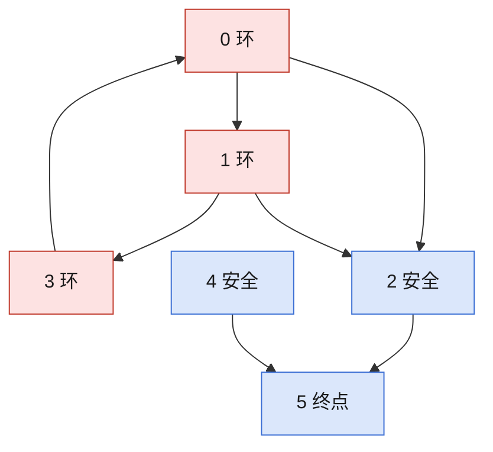

## Q
**LC 802 找到最终的安全状态**｜Medium

有向图用邻接表 `graph` 给出，出度为 0 的是终点。若从某点出发的每条路径都能到终点，则它是安全点。按升序返回所有安全点。

## A
**一句话。** 三色 DFS 判环：走到「在栈上」的点说明有环，环上的点和能走到环的点都不安全。

**图解。** 0、1、3 成环，走进环的点都不安全；只通向终点的点安全。



```python
def eventual_safe_nodes(graph):
    n = len(graph)
    color = [0] * n                 # 0 未访问，1 在栈上，2 安全
    def safe(x):
        if color[x]:
            return color[x] == 2    # 遇到栈上的点 = 有环
        color[x] = 1
        for y in graph[x]:
            if not safe(y):
                return False
        color[x] = 2
        return True
    return [i for i in range(n) if safe(i)]
```

**复杂度。** 时间 `O(n + m)`，空间 `O(n)`。

**易错点。**
- 只用「已访问」两色：走到另一条路径上已访问的安全点和走回栈上的点分不开，必须区分「在栈上」和「已确定安全」。
- 失败后把颜色改回 `0`：不安全的点要一直留在 `1`，再次遇到直接判不安全，否则同一个环会被反复搜。
- 终点的出度是 0：循环不进入，直接标成安全，别特判漏掉。

**追问。**
- 不用递归怎么做？：反向建图，出度为 0 的点入队，依次删掉并把前驱出度减一，拓扑排序里能出队的点就是安全点。
- 为什么两种做法等价？：安全点就是最终不在任何环上、也走不进环的点，拓扑排序剥掉的正是这些。

**同模式。** LC 207 课程表、LC 210 课程表 II、LC 1462 课程表 IV
