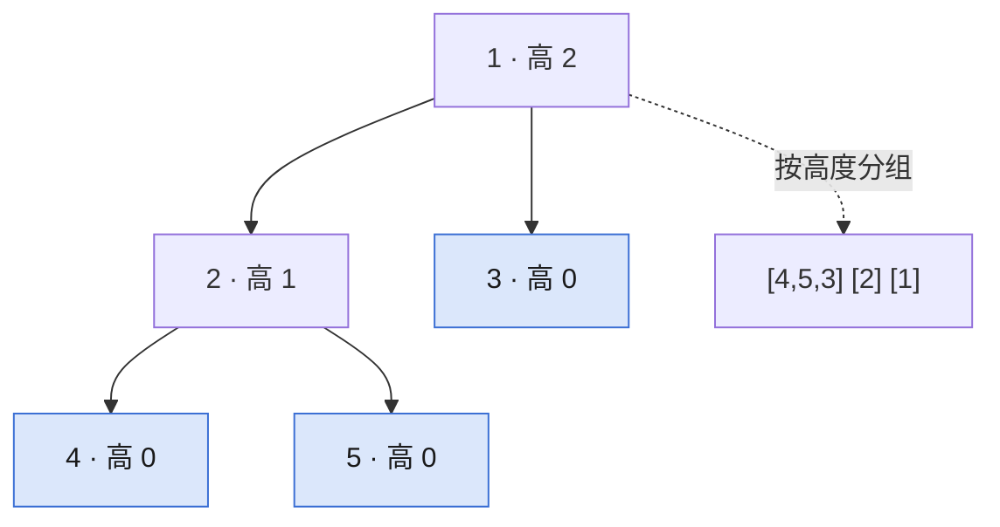

## Q
**LC 366 寻找二叉树的叶子节点**｜Medium

反复收集并删除二叉树当前所有叶子，直到树空；按轮次返回每轮收集到的节点值。

## A
**一句话。** 后序求高度（叶子为 0），节点第几轮被删就等于它的高度，按高度把值放进对应的组，一次遍历完成。

**图解。** 节点高度 = 1 + 子树高度的最大值，叶子为 0；高度相同的节点在同一轮被删。



```python
def find_leaves(root):
    res = []
    def height(node):   # 叶子高度 0，第几轮被删 = 高度
        if not node:
            return -1
        h = 1 + max(height(node.left), height(node.right))
        if h == len(res):
            res.append([])
        res[h].append(node.val)
        return h
    height(root)
    return res
```

**复杂度。** 时间 `O(n)`，空间 `O(h)` 递归栈加输出。

**易错点。**
- 求深度而不是高度：深度从根往下数，与删除轮次无关；要从叶子往上数。
- 空节点返回 0：叶子就成了高度 1，第一组为空。

**追问。**
- 真的要模拟删除吗？：可以每轮 DFS 摘叶子，但最坏 `O(n²)`；按高度分组一次遍历即可。
- 同一组内的顺序？：后序遍历先左后右，组内从左到右，和逐轮删除的顺序一致。

**同模式。** LC 104 二叉树的最大深度、LC 543 二叉树的直径、LC 110 平衡二叉树、LC 1325 删除给定值的叶子节点
