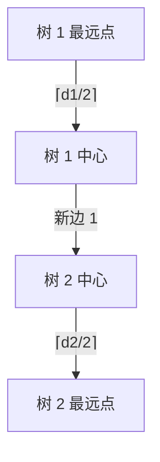

## Q
**LC 3203 合并两棵树后的最小直径**｜Hard

两棵树（各 `<= 10^5` 个点）之间必须加一条边连成一棵树，求合并后直径的最小值。

## A
**一句话。** 新直径要么是原来某棵树的直径，要么穿过新边；连接两棵树的中心时穿过新边的最长路径最短，为 `⌈d1/2⌉ + ⌈d2/2⌉ + 1`，三者取最大。

**图解。** 中心到树内最远点的距离是半径 `⌈d/2⌉`，连两个中心后最长的跨树路径就是两个半径加新边。



```python
def minimum_diameter_after_merge(edges1, edges2):
    def diameter(edges):
        g = [[] for _ in range(len(edges) + 1)]
        for a, b in edges:
            g[a].append(b)
            g[b].append(a)
        res = 0
        def dfs(u, fa):        # u 往下最长链的边数
            nonlocal res
            best = 0
            for v in g[u]:
                if v != fa:
                    d = dfs(v, u) + 1
                    res = max(res, best + d)  # 两条链拼成直径
                    best = max(best, d)
            return best
        dfs(0, -1)
        return res

    d1, d2 = diameter(edges1), diameter(edges2)
    return max(d1, d2, (d1 + 1) // 2 + (d2 + 1) // 2 + 1)
```

**复杂度。** 时间 `O(n + m)`，空间 `O(n + m)`。

**易错点。**
- 只算 `⌈d1/2⌉ + ⌈d2/2⌉ + 1`：一棵树很大另一棵很小时，原直径更长。
- 半径用 `d // 2`：奇数直径的中心在边上，最远距离要向上取整。

**追问。**
- 为什么连中心最优？：跨树路径长 = 树 1 里离接点最远的距离 + 1 + 树 2 里的同样距离，各自在中心处取最小，即半径。
- 两次 BFS 求直径？：从任一点 BFS 到最远点 `x`，再从 `x` BFS 的最远距离就是直径，适合深树避免递归。

**同模式。** LC 543 二叉树的直径、LC 1245 树的直径、LC 310 最小高度树
