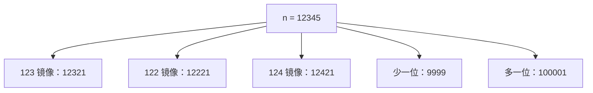

## Q
**LC 564 寻找最近的回文数**｜Hard

字符串 `n` 表示一个整数（`< 10^18`），求与它差的绝对值最小的回文数（不含自身），一样近取较小的。

## A
**一句话。** 答案只可能是五个候选：前半部分 `p`、`p-1`、`p+1` 镜像出的回文数，以及位数变化时的 `99…9` 和 `100…01`；去掉自身后按（距离，数值）取最小。

**图解。** 以 `12345` 为例：三个镜像候选加两个跨位数的候选。



```python
def nearest_palindromic(n):
    L, x = len(n), int(n)
    cands = {10 ** (L - 1) - 1, 10 ** L + 1}  # 99…9、100…01
    pre = int(n[:(L + 1) // 2])               # 前半（含中间位）
    for p in (pre - 1, pre, pre + 1):
        s = str(p)
        cands.add(int(s + s[:L // 2][::-1]))  # 镜像出后半
    cands.discard(x)           # 不含自身
    return str(min(cands, key=lambda c: (abs(c - x), c)))
```

**复杂度。** 时间 `O(L)`，空间 `O(L)`。

**易错点。**
- 只取前半镜像：`n` 本身是回文（如 `"121"`）时必须看 `p±1`。
- 忘了跨位数：`"10"` 的答案是 `"9"`，`"99"` 的答案是 `"101"`，靠 `99…9` 和 `100…01` 兜住。

**追问。**
- 为什么只改中间位附近？：高位决定量级，保持前半不变或只差 1 时距离最小；改更低位的任何回文都由前半唯一决定。
- 同距离为什么取较小？：题目规定；`key` 里把数值放第二位即可。

**同模式。** LC 9 回文数、LC 906 超级回文数、LC 2081 k 镜像数字的和
