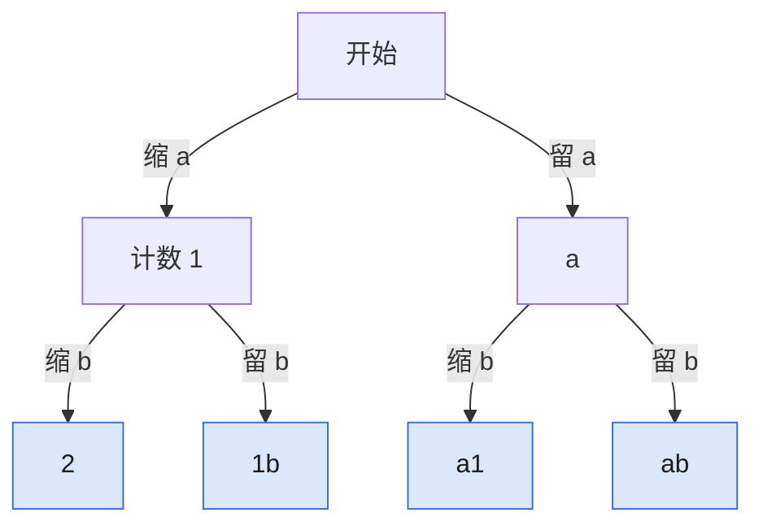

## Q
**LC 320 列举单词的全部缩写**｜Medium

单词的缩写把任意多段不相邻的子串各自替换成它们的长度，如 `word` 可缩成 `w1rd`、`2r1`、`4`。给单词，返回所有可能的缩写（任意顺序）。

## A
**一句话。** 每个字母二选一：缩写掉（累计连续被缩写的个数）或保留（先把累计的数字写出来再放字母），回溯穷举 `2^n` 种。

**图解。** 对 `ab` 的决策树：每一层选「缩」或「留」，叶子就是一个缩写。



```python
def generate_abbreviations(word):
    n, res = len(word), []
    def dfs(i, cur, cnt):        # cnt：连续被缩写的字母数
        tail = str(cnt) if cnt else ""
        if i == n:
            res.append(cur + tail)
            return
        dfs(i + 1, cur, cnt + 1)               # 缩写第 i 个
        dfs(i + 1, cur + tail + word[i], 0)    # 保留第 i 个
    dfs(0, "", 0)
    return res
```

**复杂度。** 时间 `O(n · 2^n)`，空间 `O(n)`（递归栈，不计结果）。

**易错点。**
- 保留字母前忘了先写出累计数字：`a1` 会变成 `1a` 之类的错误顺序。
- 到末尾时忘了写剩余计数：以缩写结尾的串（如 `2`）会丢失数字。
- 把相邻的缩写拆成两个数字（如 `11` 代替 `2`）：必须合并成连续一段，所以要用计数累计。

**追问。**
- 也可以用位掩码吗？：枚举 `0..2^n - 1`，每位表示该字母保留或缩写，再把连续的缩写合并成数字。
- 和 LC 78 子集的关系？：缩写方案与「保留字母的子集」一一对应。

**同模式。** LC 78 子集、LC 408 有效单词缩写、LC 527 单词缩写、LC 17 电话号码的字母组合
