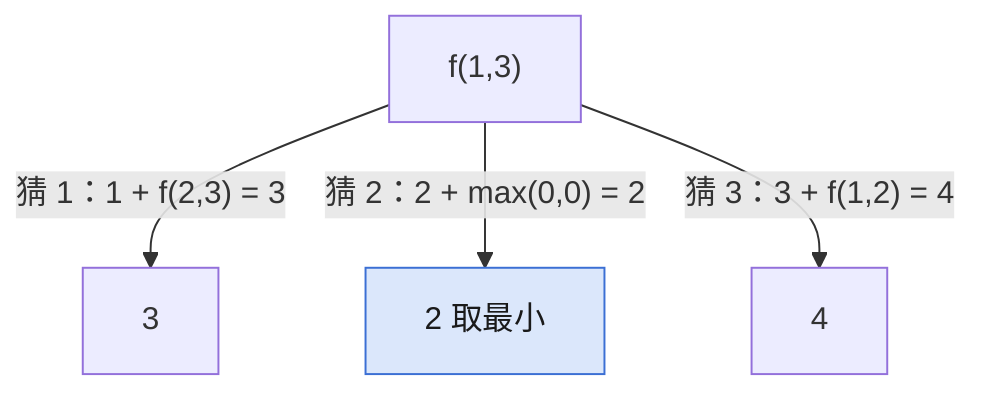

## Q
**LC 375 猜数字大小 II**｜Medium

我在 `1..n` 里选一个数，你来猜。猜错了你付你猜的数那么多钱，并被告知大了还是小了。求保证一定能猜中所需的最少现金。

## A
**一句话。** 区间 minimax：在 `[l, r]` 里猜 `x`，最坏情况是接着走更贵的那一侧，所以花费是 `x + max(f(l,x-1), f(x+1,r))`，再对所有 `x` 取最小。

**图解。** `n = 3`：猜 2 花 2 元，两侧各剩一个数必中，总共 2 元最少。



```python
def get_money_amount(n):
    @cache
    def f(l, r):                       # [l, r] 里保证赢的最小花费
        if l >= r:
            return 0                   # 只剩一个数，直接猜中
        return min(x + max(f(l, x - 1), f(x + 1, r))
                   for x in range(l, r + 1))
    return f(1, n)
```

**复杂度。** 时间 `O(n³)`，空间 `O(n²)`。

**易错点。**
- 求期望或平均：要的是最坏情况下的最小花费，是 `min` 套 `max`。
- 对半猜：不一定最优，大数猜错代价高，所以最优猜测偏右。
- 区间只剩一个数时仍计花费：猜中不用付钱，所以 `l >= r` 返回 `0`。

**追问。**
- 为什么是 `max`？：对手总是让你落在更贵的一边，要保证无论怎样都够，必须按最坏情况备钱。
- 怎么优化？：`x` 只需在区间右半枚举（偏右更优），常数减半；也可改成自底向上的区间 DP 表。

**同模式。** LC 486 预测赢家、LC 877 石子游戏、LC 887 鸡蛋掉落、LC 312 戳气球
