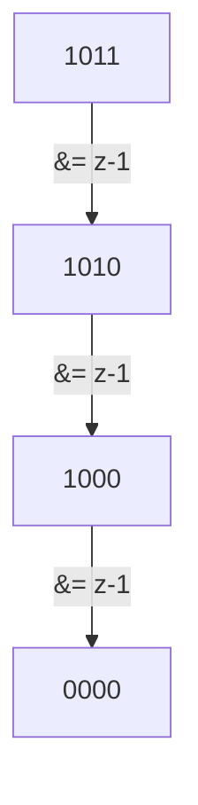

## Q
**LC 461 汉明距离**｜Easy

给两个整数 `x`、`y`，返回它们二进制表示中对应位不同的位置个数。

## A
**一句话。** 异或后不同的位变成 `1`，再数 `1` 的个数；`z &= z - 1` 每次恰好去掉最低位的那个 `1`。

**图解。** `z = 1011` 去三次：每次 `z & (z-1)` 少一个 1。



```python
def hamming_distance(x, y):
    z, cnt = x ^ y, 0          # 不同的位 = 1
    while z:
        z &= z - 1             # 去掉最低位的 1
        cnt += 1
    return cnt
```

**复杂度。** 时间 `O(1 的个数)`，不超过 `O(log max)`，空间 `O(1)`。

**易错点。**
- 用 `x - y` 或比较大小：汉明距离看的是逐位异同，一定先异或。
- 写成 `z &= z + 1`：`z + 1` 会让低位的 0 变 1，不会去掉最低位的 1。
- 负数：Python 整数无限位，`-1 & ...` 会死循环，题目是非负数，若含负数先掩码到 32 位。

**追问。**
- 为什么 `z & (z-1)` 去掉最低位 1？：`z-1` 把最低位 1 变 0、其右边的 0 全变 1，与 `z` 相与右边全清零。
- 一个数组里所有数对的汉明距离之和？：逐位统计，该位有 `a` 个 1、`n-a` 个 0，贡献 `a·(n-a)`，`O(32n)`，即汉明距离总和。

**同模式。** LC 191 位1的个数、LC 338 比特位计数、LC 136 只出现一次的数字
