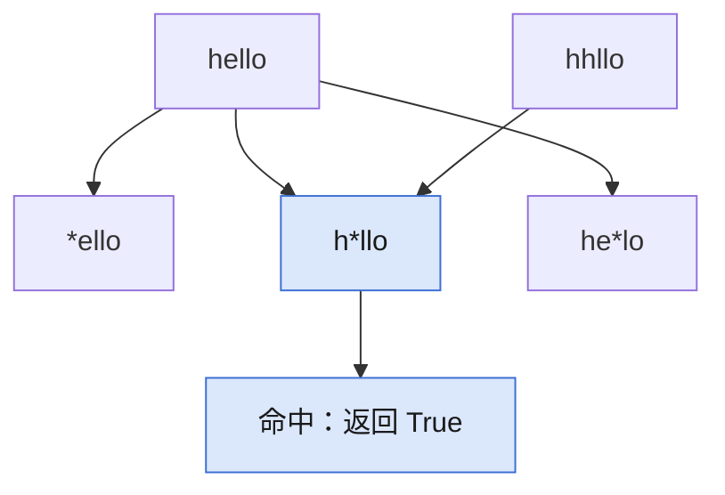

## Q
**LC 676 实现一个魔法字典**｜Medium

`build_dict(dictionary)` 载入一组单词；`search(word)` 判断能否把 `word` 中恰好一个字母改成另一个字母，使结果在字典里。

## A
**一句话。** 把每个字典词的每个位置换成通配符 `*`，统计每个模式出现几次；查询时枚举 `word` 的每个模式，命中其他单词就行。

**图解。** 字典 `hello`：模式 `*ello`、`h*llo` 等各计 1；查 `hhllo` 得 `h*llo`，命中了 `hello`，且 `hhllo` 本身不在字典里。



```python
class MagicDictionary:
    def __init__(self):
        self.words = set()
        self.cnt = Counter()          # 通配模式 -> 单词数

    def build_dict(self, dictionary):
        self.words = set(dictionary)
        for w in self.words:
            for i in range(len(w)):
                self.cnt[w[:i] + "*" + w[i + 1:]] += 1

    def search(self, word):
        own = word in self.words      # 自己也会命中自己的模式
        for i in range(len(word)):
            key = word[:i] + "*" + word[i + 1:]
            if self.cnt[key] - own > 0:
                return True
        return False
```

**复杂度。** 建表 `O(总字符数 × L)`，查询 `O(L^2)`，空间 `O(总字符数 × L)`。

**易错点。**
- 命中自己：`word` 本身在字典里时它的模式至少计 1，必须扣掉，否则「改 0 个字母」也返回真。
- 模式只计「是否存在」：同一个模式可由两个不同单词产生，只存布尔会让「自己 + 另一个」被误扣。

**追问。**
- 用字典树怎么做？：沿 Trie 走，允许恰好一次走到不同字母的分支，其余必须匹配。
- 字典很大、查询很多？：模式哈希表以空间换时间，查询只与词长有关。

**同模式。** LC 211 添加与搜索单词、LC 720 词典中最长的单词、LC 953 验证外星语词典
