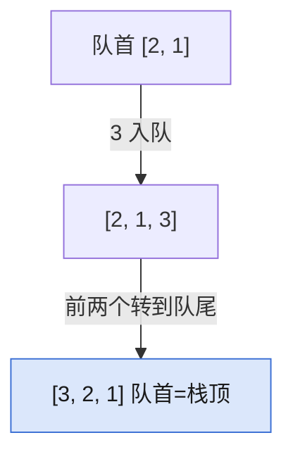

## Q
**LC 225 用队列实现栈**｜Easy

只用队列的标准操作（入队、出队、查看队首、判空）实现栈：`push`、`pop`、`top`、`empty`。

## A
**一句话。** 只用一个队列：新元素入队后，把它前面的所有旧元素依次出队再入队，让新元素转到队首。

**图解。** 队列 `[2,1]` 里压入 `3`：先入队得 `[2,1,3]`，再把前两个转到后面，变成 `[3,2,1]`，队首就是栈顶。



```python
class MyStack:
    def __init__(self):
        self.q = deque()

    def push(self, x):
        self.q.append(x)
        for _ in range(len(self.q) - 1):   # 旧元素转到 x 后面
            self.q.append(self.q.popleft())

    def pop(self):
        return self.q.popleft()

    def top(self):
        return self.q[0]

    def empty(self):
        return not self.q
```

**复杂度。** 时间 `push` 为 `O(n)`，其余 `O(1)`，空间 `O(n)`。

**易错点。**
- 转的次数写成 `len(q)`：会把新元素也转走，应是 `len(q) - 1`。
- 把 `pop` 做成 `O(n)`、`push` 做成 `O(1)`：也可行，但本写法让读操作都 `O(1)`，要选一边。
- 用了 `deque` 的 `pop()` 或下标：题目只允许队列操作，`popleft` 与 `q[0]` 对应出队和队首。

**追问。**
- 用两个队列怎么做？：入队到空队列，再把旧队列全部倒进来，交换两队，与一个队列的做法等价。
- 能做到 `push` 和 `pop` 都均摊 `O(1)` 吗？：栈不能，这是队列模拟栈的代价；反过来用两个栈做队列可以均摊 `O(1)`。

**同模式。** LC 232 用栈实现队列、LC 155 最小栈、LC 641 设计循环双端队列、LC 716 最大栈
