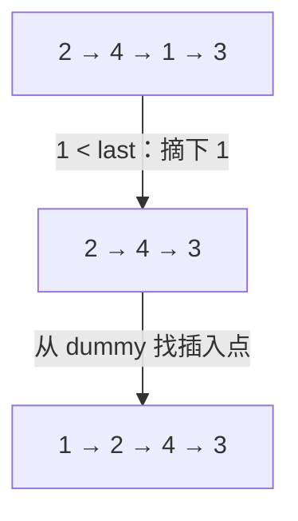

## Q
**LC 147 对链表进行插入排序**｜Medium

用插入排序把单链表升序排列，返回新头结点。

## A
**一句话。** 哑结点加「已排序部分的尾 `last`」：`cur` 不小于 `last` 就直接延长有序段，否则摘下 `cur`，从头找到第一个大于它的结点前面插进去。

**图解。** `cur = 1` 小于 `last = 4`：先摘下 1，再从 `dummy` 往后找插入点，插到 `dummy` 后面。



```python
def insertion_sort_list(head):
    dummy = ListNode(0, head)
    last, cur = head, head.next    # last：有序段的尾
    while cur:
        if cur.val >= last.val:
            last = cur             # 已在正确位置
        else:
            prev = dummy           # 从头找插入点
            while prev.next.val <= cur.val:
                prev = prev.next
            last.next = cur.next   # 摘下 cur
            cur.next = prev.next   # 插到 prev 后面
            prev.next = cur
        cur = last.next
    return dummy.next
```

**复杂度。** 时间 `O(n²)`，空间 `O(1)`。

**易错点。**
- 插入后 `cur = cur.next`：`cur` 已被移走，下一个待处理的是 `last.next`。
- 不判断 `cur >= last` 就从头找：有序输入也会退化成每次扫一遍。

**追问。**
- 更快的链表排序？：归并排序，快慢指针找中点后递归合并，`O(n log n)`，就是 LC 148。
- 为什么用哑结点？：新结点可能插到最前面，哑结点让「插到头部」和「插到中间」写法一致。

**同模式。** LC 148 排序链表、LC 21 合并两个有序链表
