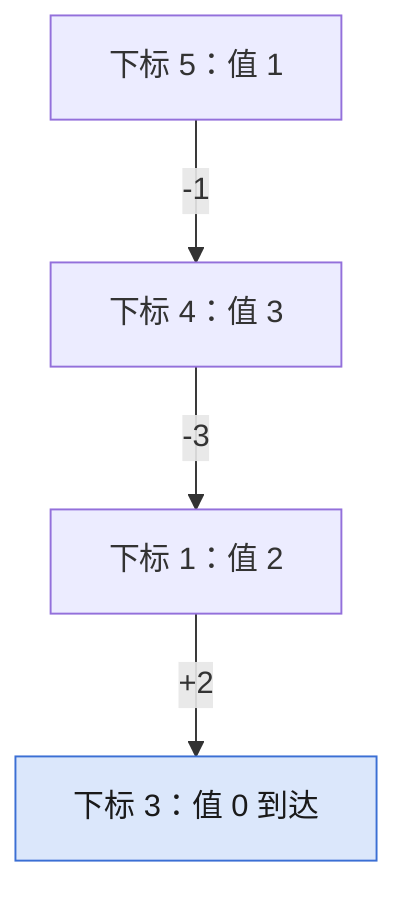

## Q
**LC 1306 跳跃游戏 III**｜Medium

非负整数数组 `arr` 和起点 `start`。在下标 `i` 时可以跳到 `i + arr[i]` 或 `i - arr[i]`，不能跳出数组。能否到达某个值为 `0` 的下标？

## A
**一句话。** 把下标当结点、两种跳法当边，从 `start` 出发 DFS，走到值为 0 的下标返回真，走过的下标不再走。

**图解。** `arr = [4,2,3,0,3,1,2]`，`start = 5`：`5 → 4 → 1 → 3`，下标 3 的值为 0。



```python
def can_reach(arr, start):
    n = len(arr)
    seen = set()
    def dfs(i):
        if not 0 <= i < n or i in seen:
            return False              # 出界或走过
        if arr[i] == 0:
            return True
        seen.add(i)
        return dfs(i + arr[i]) or dfs(i - arr[i])
    return dfs(start)
```

**复杂度。** 时间 `O(n)`，空间 `O(n)`。

**易错点。**
- 不记录访问：图里有环（`arr[i] = 0` 之外的互跳），会无限递归。
- 先判 `arr[i] == 0` 再判出界：下标越界会报错，要先判范围。
- 值为 0 的下标本身也算：起点就是 0 时直接返回真。

**追问。**
- 数组很长递归会爆栈怎么办？：改成 BFS 队列或显式栈，逻辑相同。
- 求最少跳几次？：BFS 按层数，首次到达值为 0 的下标时的层数。

**同模式。** LC 1345 跳跃游戏 IV、LC 55 跳跃游戏、LC 45 跳跃游戏 II、LC 403 青蛙过河
