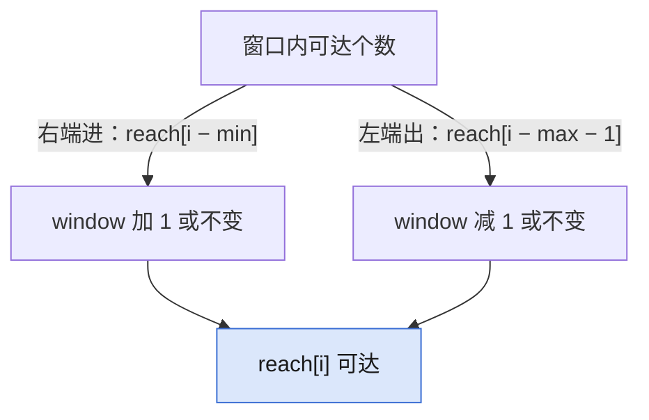

## Q
**LC 1871 跳跃游戏 VII**｜Medium

二进制字符串 `s`，从下标 `0` 出发，可以从 `i` 跳到 `j` 当且仅当 `min_jump ≤ j - i ≤ max_jump` 且 `s[j] == '0'`。判断能否到达最后一个下标。

## A
**一句话。** `reach[i]` 为真，当且仅当 `s[i]` 是 `0` 且 `[i - max_jump, i - min_jump]` 内至少有一个可达下标；用滑动窗口维护窗口内可达下标的个数。

**图解。** 对每个 `i`，窗口 `[i - max_jump, i - min_jump]` 随 `i` 右移：右端新增一个下标，左端滑出一个。



```python
def can_reach(s, min_jump, max_jump):
    n = len(s)
    reach = [False] * n
    reach[0] = True
    window = 0                   # 窗口内可达下标的个数
    for i in range(1, n):
        if i >= min_jump:
            window += reach[i - min_jump]       # 右端进
        if i > max_jump:
            window -= reach[i - max_jump - 1]   # 左端出
        reach[i] = window > 0 and s[i] == "0"
    return reach[n - 1]
```

**复杂度。** 时间 `O(n)`，空间 `O(n)`。

**易错点。**
- 对每个 `i` 都扫描窗口：`O(n · max_jump)` 会超时，窗口计数才是线性。
- 窗口左端下标写成 `i - max_jump`：滑出去的是 `i - max_jump - 1`。
- 起点 `reach[0]` 不设为真：整个转移无从开始。

**追问。**
- 也可以用 BFS 吗？：可以，配合「已扩展到的最远下标」避免重复扫描，同样线性。
- 差分数组怎么做？：从可达的 `i` 给 `[i + min, i + max]` 加 1，用差分累加判断每个位置是否被覆盖。

**同模式。** LC 55 跳跃游戏、LC 403 青蛙过河、LC 1696 跳跃游戏 VI、LC 1306 跳跃游戏 III
