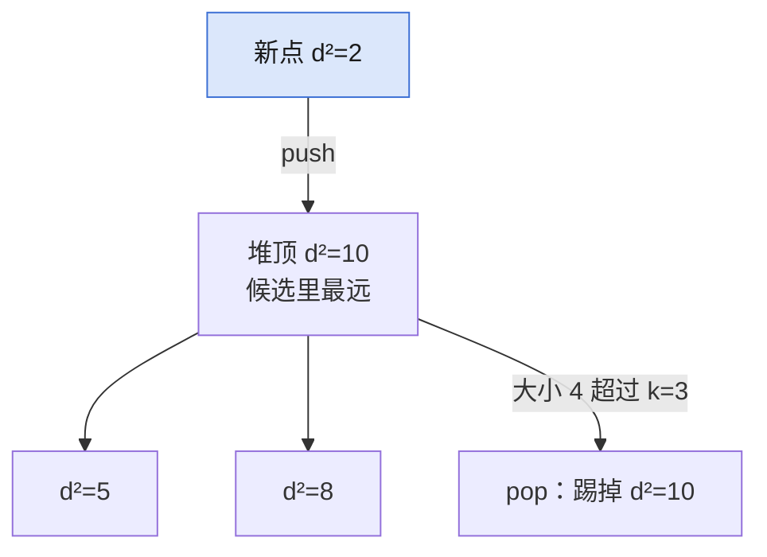

## Q
**LC 973 最接近原点的 K 个点**｜Medium

给定平面上的点 `points` 和整数 `k`，返回离原点最近的 `k` 个点，顺序不限。

## A
**一句话。** 维护大小为 `k` 的大根堆，堆顶是候选里最远的，超出就弹掉。

**图解。** 大小为 `k` 的大根堆：新点入堆后超出 `k`，就把堆顶最远的弹掉。



```python
def k_closest(points, k):
    heap = []                         # 距离取负：大根堆
    for i, (x, y) in enumerate(points):
        heappush(heap, (-(x*x + y*y), i))   # 比平方，不用开方
        if len(heap) > k:
            heappop(heap)             # 踢掉最远的
    return [points[i] for _, i in heap]
```

**复杂度。** 时间 `O(n log k)`，空间 `O(k)`。

**易错点。**
- 用小根堆再弹堆顶：弹掉的是最近的，`([[1,3],[-2,2]], 1)` 得 `[[1,3]]`，应为 `[[-2,2]]`。
- 对距离开方再比较：多余且有浮点误差，平方顺序相同。

**追问。**
- 能做到平均 `O(n)` 吗？：快速选择（quickselect），枢轴要随机，否则有序输入退化成 `O(n²)`。

**同模式。** LC 215 数组中的第 K 个最大元素、LC 347 前 K 个高频元素、LC 703 数据流中的第 K 大元素
