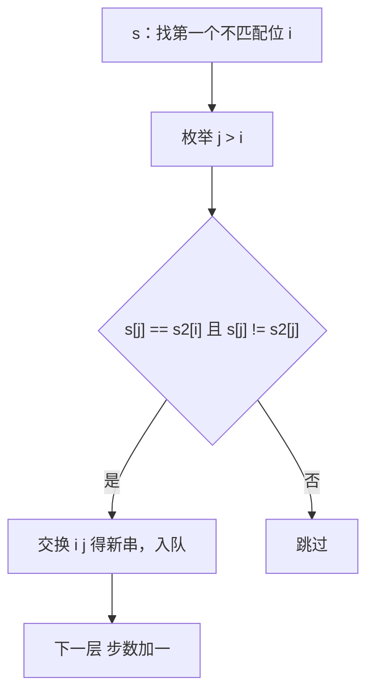

## Q
**LC 854 相似度为 K 的字符串**｜Hard

`s1`、`s2` 是由同一组字符组成的变位词。每次交换 `s1` 中两个字符的位置，求把 `s1` 变成 `s2` 的最少交换次数。

## A
**一句话。** BFS：每步只修第一个不匹配位 `i`，在后面找能把它修好、且自己位置原本不对的字符交换，剪枝后分支很少。

**图解。** 每一层 BFS 对应一次交换；只交换「能让位置 `i` 变对，且来源位置 `j` 本来就不对」的字符，避免无意义的分支。



```python
def k_similarity(s1, s2):
    q, seen, step = deque([s1]), {s1}, 0
    while q:
        for _ in range(len(q)):
            s = q.popleft()
            if s == s2:
                return step
            i = 0
            while s[i] == s2[i]:       # 第一个不匹配位
                i += 1
            for j in range(i + 1, len(s)):
                # 把 i 位修好，且不破坏 j 位已匹配的
                if s[j] == s2[i] and s[j] != s2[j]:
                    t = list(s)
                    t[i], t[j] = t[j], t[i]
                    t = "".join(t)
                    if t not in seen:
                        seen.add(t)
                        q.append(t)
        step += 1
    return -1
```

**复杂度。** 时间 指数级但剪枝后很小（`n ≤ 20`），空间 同量级。

**易错点。**
- 枚举任意两个位置交换：状态爆炸，每步只处理第一个不匹配位。
- 允许把已匹配的位置换走：`s[j] != s2[j]` 保证不破坏已对的位置。
- 不记录访问过的串：同一个串会被多次入队。

**追问。**
- 为什么只修第一个不匹配位是对的？：这一位迟早要被修好，先修不会增加最少步数。
- 更快的做法？：按「位置错配图」分解成环，最少交换数 = `n` − 最大环分解数，是 DFS 剪枝的思路。

**同模式。** LC 773 滑动谜题、LC 127 单词接龙、LC 1247 交换字符使得字符串相同
