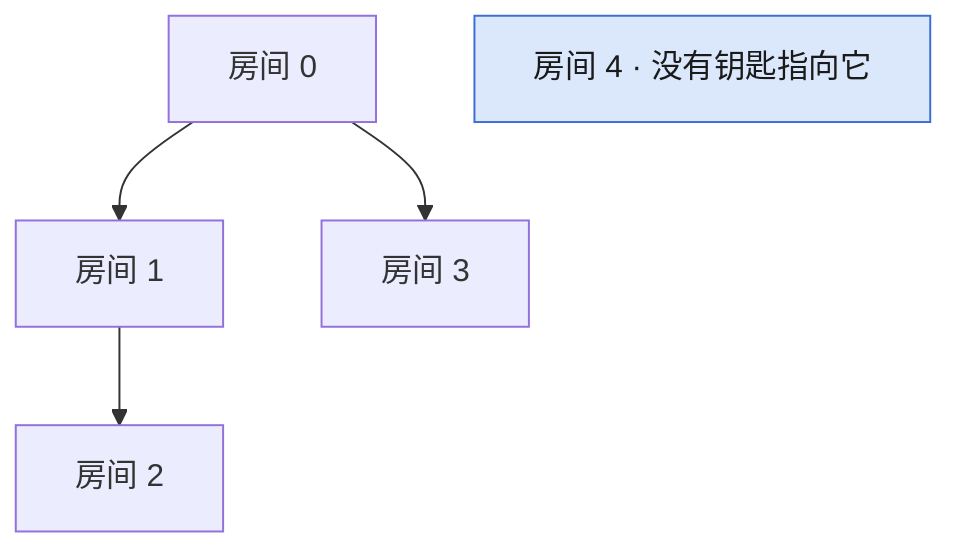

## Q
**LC 841 钥匙和房间**｜Medium

有 `n` 个房间，房间 `0` 开着，其余上锁。`rooms[i]` 是房间 `i` 里能找到的钥匙（每把钥匙对应一个房间号）。判断能否进入所有房间。

## A
**一句话。** 把房间当结点、钥匙当有向边，从 `0` 出发 DFS，看能否访问到全部结点。

**图解。** 从房间 0 拿到钥匙 1、3，逐个深入；若某个房间的钥匙都在已访问过的房间里，就是没人能打开它。



```python
def can_visit_all_rooms(rooms):
    seen = {0}
    def dfs(u):
        for v in rooms[u]:       # 每把钥匙开一个房间
            if v not in seen:
                seen.add(v)
                dfs(v)
    dfs(0)
    return len(seen) == len(rooms)
```

**复杂度。** 时间 `O(n + k)`（`k` 为钥匙总数），空间 `O(n)`。

**易错点。**
- 忘了从房间 `0` 起步就把它标成已访问：`0` 开着，必须一开始放进 `seen`。
- 出栈才标记已访问：入栈就要标记，否则同一个房间可能被重复压入。

**追问。**
- 用 BFS 行吗？：行，队列代替递归，只关心可达性，两者等价。
- 要找哪些房间进不去？：返回 `set(range(n)) - seen`。

**同模式。** LC 547 省份数量、LC 133 克隆图、LC 1334 阈值距离内邻居最少的城市、LC 797 所有可能的路径
