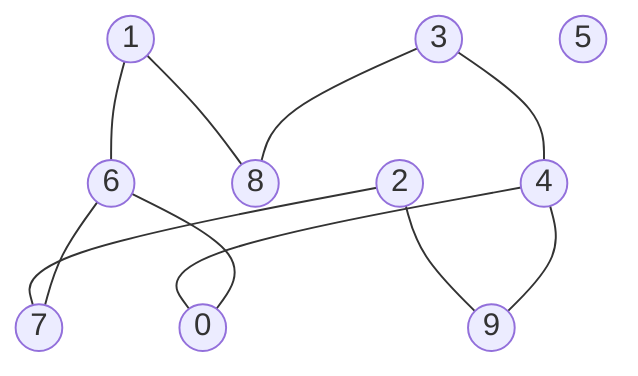

## Q
**LC 935 骑士拨号器**｜Medium

骑士在电话键盘（`1-9` 三行，`0` 在底部中间）上走「日」字，从任意数字出发走 `n-1` 步，经过的数字连成号码。求长度为 `n` 的不同号码数，对 `10^9+7` 取余。

## A
**一句话。** 状态是「当前停在哪个数字」，`f[d]` 是以 `d` 结尾的号码数，每步按骑士跳的邻接表转移一次，共 `n-1` 轮。

**图解。** 骑士在键盘上能互跳的数字对；`5` 跳不出去，只在 `n = 1` 时算一个号码。



```python
def knight_dialer(n):
    MOD = 10**9 + 7
    nxt = [[4, 6], [6, 8], [7, 9], [4, 8], [0, 3, 9],
           [], [0, 1, 7], [2, 6], [1, 3], [2, 4]]
    f = [1] * 10               # f[d]：以 d 结尾的号码数
    for _ in range(n - 1):
        g = [0] * 10
        for d in range(10):
            for e in nxt[d]:
                g[e] += f[d]   # 从 d 跳到 e
        f = [x % MOD for x in g]
    return sum(f) % MOD
```

**复杂度。** 时间 `O(n)`（每轮 20 条边），空间 `O(1)`。

**易错点。**
- 把 `*`、`#` 当成可停的格子：只能停在数字上。
- 漏了 `5`：`n = 1` 时 `5` 本身也是一个号码，答案是 10。

**追问。**
- `n` 到 `10^18`？：转移是固定的 `10×10` 矩阵，矩阵快速幂 `O(10³ log n)`。
- 利用对称性？：按位置把数字分成 `{1,3,7,9}`、`{2,8}`、`{4,6}`、`{0}` 四类，状态从 10 个缩到 4 个。

**同模式。** LC 70 爬楼梯、LC 1220 统计元音字母序列的数目、LC 688 骑士在棋盘上的概率
