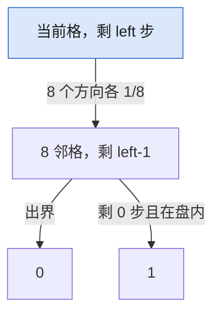

## Q
**LC 688 骑士在棋盘上的概率**｜Medium

`n×n` 的棋盘上，骑士从 `(row, column)` 出发，每步等概率地（各 `1/8`）选 8 种走法之一，即使会走出棋盘也照走，共走 `k` 步，或走出棋盘就停。求走完 `k` 步后仍在棋盘上的概率。

## A
**一句话。** 记忆化递归：`f(r, c, left)` 是从 `(r, c)` 还要走 `left` 步仍在棋盘内的概率，等于 8 个方向的 `f` 之和除以 8；出界为 0，没步数了为 1。

**图解。** 每走一步概率拆成 8 份，各自递归。



```python
def knight_probability(n, k, row, column):
    moves = ((1, 2), (2, 1), (-1, 2), (-2, 1),
             (1, -2), (2, -1), (-1, -2), (-2, -1))
    @cache
    def f(r, c, left):                   # 还剩 left 步，仍在盘内的概率
        if not (0 <= r < n and 0 <= c < n):
            return 0.0                   # 已出界
        if left == 0:
            return 1.0                   # 走完且在盘内
        return sum(f(r + dr, c + dc, left - 1)
                   for dr, dc in moves) / 8
    return f(row, column, k)
```

**复杂度。** 时间 `O(k·n²)`，空间 `O(k·n²)`。

**易错点。**
- 先判步数再判出界：步数为 0 时如果已经在界外，应为 0，所以先判出界。
- 概率相加忘了除以 8：每个方向概率是 `1/8`。
- 统计「走法数」再除以 `8^k`：数字会很大，直接传概率更稳。

**追问。**
- 想改成迭代 DP？：`dp[step][r][c]` 为 `step` 步后在 `(r, c)` 且从未出界的概率，从起点向前推，最后求和。
- 和「出界的路径数」的关系？：同一类格子上的计数 DP，一个数出界，一个数留在界内。

**同模式。** LC 576 出界的路径数、LC 935 骑士拨号器、LC 837 新 21 点、LC 1220 统计元音字母序列的数目
