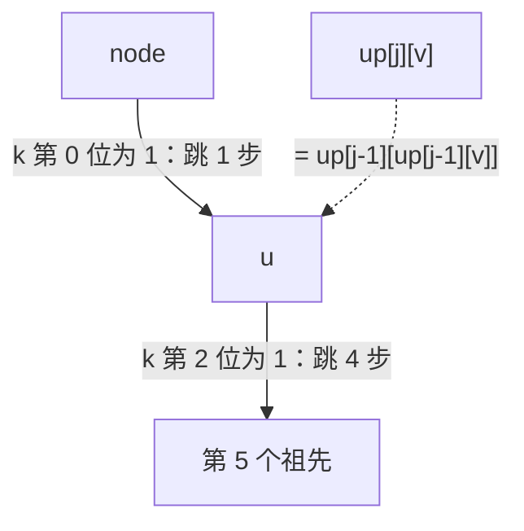

## Q
**LC 1483 树节点的第 K 个祖先**｜Hard

树有 `n` 个结点（根为 `0`），`parent[i]` 是结点 `i` 的父结点（`parent[0] = -1`）。设计 `getKthAncestor(node, k)`，返回 `node` 的第 `k` 个祖先，不存在返回 `-1`。会多次查询。

## A
**一句话。** 倍增：预处理 `up[j][v]` 为 `v` 的第 `2^j` 个祖先，查询时把 `k` 按二进制拆开，逐位跳。

**图解。** `k = 5 = 4 + 1`：先跳 `2^0 = 1` 步，再跳 `2^2 = 4` 步，只需 `log k` 次查表，`up[j]` 由 `up[j-1]` 自己和自己复合得到。



```python
class TreeAncestor:
    def __init__(self, n, parent):
        self.n = n
        # up[j][v]：v 的第 2^j 个祖先，-1 表示不存在
        self.up = [parent]
        for _ in range(1, n.bit_length()):
            p = self.up[-1]
            self.up.append([-1 if p[v] < 0 else p[p[v]]
                            for v in range(n)])

    def getKthAncestor(self, node, k):
        if k >= self.n:              # 深度不会超过 n - 1
            return -1
        for j, up in enumerate(self.up):
            if k >> j & 1:           # k 的第 j 位为 1：跳 2^j 步
                node = up[node]
                if node < 0:
                    return -1
        return node
```

**复杂度。** 时间 预处理 `O(n log n)`，查询 `O(log k)`，空间 `O(n log n)`。

**易错点。**
- 一步一步往上走：链状树时每次查询 `O(n)`，多次查询会超时。
- 倍增表忘了处理 `-1`：`p[v] < 0` 时它的 `2^j` 个祖先也不存在，不能再下标。
- `k` 超过层数范围：`k ≥ n` 直接返回 `-1`，避免位数超出倍增表的行数。

**追问。**
- 倍增还能干什么？：求最近公共祖先 LCA：先把较深结点抬到同一深度，再同时向上跳到刚好不相同的位置。
- 离线怎么做？：把查询挂在结点上，DFS 时用栈直接取第 `k` 个祖先，`O(1)` 一次。

**同模式。** LC 236 二叉树的最近公共祖先、LC 1740 找到二叉树中的距离
