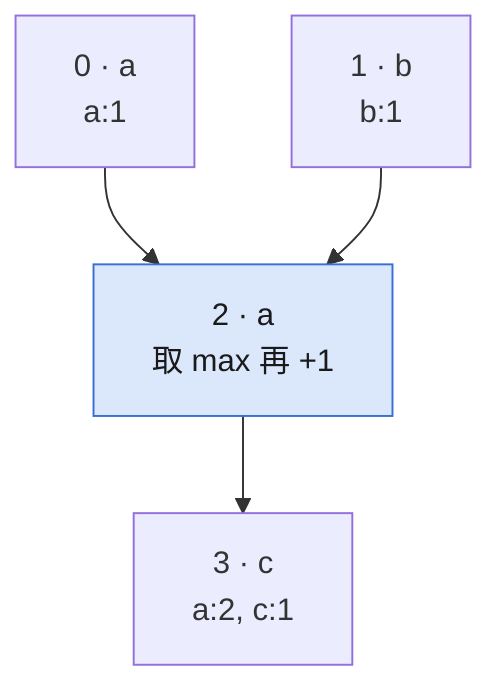

## Q
**LC 1857 有向图中最大颜色值**｜Hard

有向图的每个结点有一个小写字母表示的颜色 `colors[i]`。路径的颜色值是路径上出现次数最多的颜色的次数。求所有合法路径的最大颜色值；图中有环则返回 `-1`。

## A
**一句话。** 拓扑排序顺带做 DP：`dp[u][c]` 是以 `u` 结尾的路径上颜色 `c` 的最多出现次数；弹出 `u` 时把自己的颜色加 1，再把整行取最大传给后继；若拓扑序没有访问完所有结点就有环。

**图解。** 按拓扑序逐个结点处理，后继结点从所有前驱取每种颜色的最大值。



```python
def largest_path_value(colors, edges):
    n = len(colors)
    g = [[] for _ in range(n)]
    indeg = [0] * n
    for a, b in edges:
        g[a].append(b)
        indeg[b] += 1
    dp = [[0] * 26 for _ in range(n)]
    q = deque(i for i in range(n) if indeg[i] == 0)
    seen = best = 0
    while q:
        u = q.popleft()
        seen += 1
        dp[u][ord(colors[u]) - 97] += 1   # 算上自己的颜色
        best = max(best, max(dp[u]))
        for v in g[u]:
            for c in range(26):
                dp[v][c] = max(dp[v][c], dp[u][c])
            indeg[v] -= 1
            if indeg[v] == 0:
                q.append(v)
    return best if seen == n else -1
```

**复杂度。** 时间 `O(26 · (n + m))`，空间 `O(26 n)`。

**易错点。**
- 忘了检测环：访问到的结点数小于 `n` 就是有环，要返回 `-1`。
- 在传给后继之前没把自己的颜色加上：`dp[u]` 要先算上自己再向后传。
- 用 DFS 记忆化而不判环：递归会死循环，必须配三色标记。

**追问。**
- 为什么拓扑序适合 DP？：一个结点被弹出时它的所有前驱都已处理完，`dp[u]` 已是最终值。
- 能减少 26 吗？：对每种颜色单独跑一次最长链，同样 `O(26 (n + m))`，但空间降到 `O(n)`。

**同模式。** LC 329 矩阵中的最长递增路径、LC 2050 并行课程 III、LC 207 课程表
