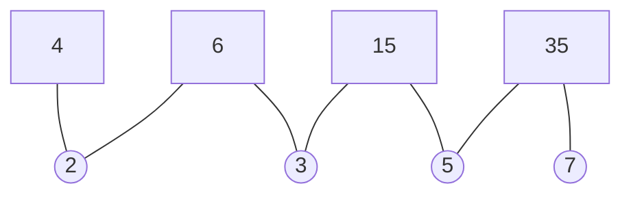

## Q
**LC 952 按公因数计算最大组件大小**｜Hard

`nums` 是互不相同的正整数数组，两个数有大于 1 的公因数时连一条边。求最大连通块的大小。

## A
**一句话。** 并查集：不要两两比较，让每个数和它的每个质因数合并，共享质因数的数自然在同一块。

**图解。** `4, 6, 15, 35`：4 连质数 2，6 连 2 和 3，15 连 3 和 5，35 连 5 和 7，一条链把四个数连成一块。



```python
def largest_component_size(nums):
    parent = {}
    def find(x):
        parent.setdefault(x, x)
        while parent[x] != x:
            parent[x] = parent[parent[x]]    # 路径折半
            x = parent[x]
        return x
    for x in nums:
        y, p = x, 2
        while p * p <= y:
            if y % p == 0:
                parent[find(x)] = find(p)    # 数和质因数同组
                while y % p == 0:
                    y //= p
            p += 1
        if y > 1:                            # 剩下的大质因数
            parent[find(x)] = find(y)
    cnt = Counter(find(x) for x in nums)
    return max(cnt.values())
```

**复杂度。** 时间 `O(n√M·α)`，空间 `O(n + 质因数个数)`。

**易错点。**
- 两两求 `gcd`：`n = 2·10^4` 时 `n²` 超时，按质因数合并是线性个数。
- 只统计数的根时把质数也算进去：计数只对 `nums` 里的数，质因数只当桥梁。
- 漏掉分解完剩下的大于 1 的质因数：如 `14 = 2 · 7`，除掉 2 后剩下 7 要合并。

**追问。**
- 如何加速分解？：先用埃氏筛预处理最小质因数，每个数 `O(log x)` 分解。
- 为什么质数可以直接用作并查集的结点？：它只是编号，与 `nums` 里是否出现无关。

**同模式。** LC 2709 最大公约数遍历、LC 684 冗余连接（Redundant Connection）
