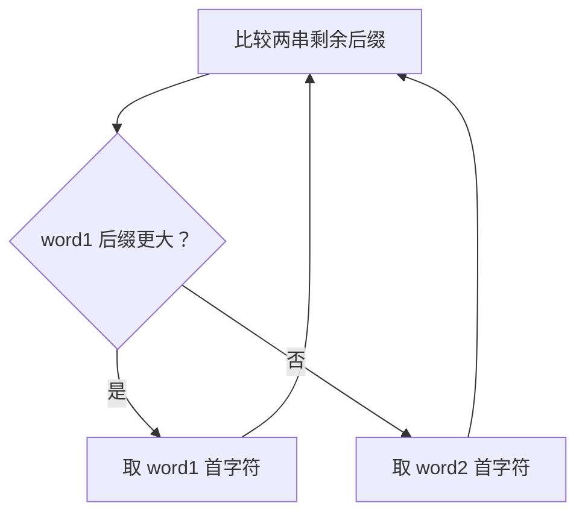

## Q
**LC 1754 构造字典序最大的合并字符串**｜Medium

给两个字符串 `word1`、`word2`。每次从其中一个串取出第一个字符追加到 `merge`，直到两个串都取空。求字典序最大的 `merge`。

## A
**一句话。** 贪心：每次比较两个串**剩余的整段后缀**，取字典序更大那个后缀的首字符；前缀相同时必须看后缀而不是只看一个字符。



```python
def largest_merge(word1, word2):
    i = j = 0
    res = []
    while i < len(word1) and j < len(word2):
        if word1[i:] > word2[j:]:       # 比整段后缀，不只是首字符
            res.append(word1[i])
            i += 1
        else:
            res.append(word2[j])
            j += 1
    res.append(word1[i:])
    res.append(word2[j:])
    return ''.join(res)
```

**复杂度。** 时间 `O((m + n)²)`，空间 `O(m + n)`。

**易错点。**
- 只比较首字符：首字符相同时（如 `"abcabc"` 与 `"abdcaba"`）会取错，要比整段后缀。
- 忘了接上剩余部分：一个串取空后，另一个串的剩余整段要原样追加。

**追问。**
- 怎么降到 `O(m + n)`？：后缀数组或把两串拼起来求后缀排名，用排名比较代替切片。

**同模式。** LC 402 移掉 K 位数字、LC 316 去除重复字母、LC 1673 找出最具竞争力的子序列、LC 321 拼接最大数
