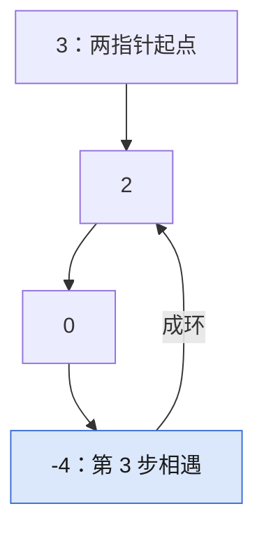

## Q
**LC 141 环形链表**｜Easy

给链表头节点 `head`，判断链表中是否有环。要求 `O(1)` 空间。

## A
**一句话。** 快慢指针（Floyd 判圈）：慢走一步、快走两步，有环则快指针必追上慢指针。

**图解。** 慢指针每次走 1 步、快指针走 2 步，第 3 步两者在 `-4` 相遇，说明有环。



```python
def has_cycle(head):
    slow = fast = head
    while fast and fast.next:   # 快指针到头说明无环
        slow = slow.next
        fast = fast.next.next
        if slow is fast:        # 先走再比，起点本来就相等
            return True
    return False
```

**复杂度。** 时间 `O(n)`，空间 `O(1)`。

**易错点。**
- 先比较再移动：起点相同，无环的 `[1,2,3]` 也返回 `True`。
- 循环只写 `while fast`：`[1]` 会对 `None` 取 `.next` 而崩。
- 用节点值判重：值可以重复，无环的 `[0,0]` 会被误判，要比较节点本身。

**追问。**
- 怎么找环的入口（LC 142）？：相遇后一个指针回到 `head`，两个都每次走一步，再次相遇处就是入口。
- 怎么求环长？：相遇后让一个指针继续走，数到回到相遇点的步数。

**同模式。** LC 142 环形链表 II、LC 202 快乐数、LC 287 寻找重复数、LC 876 链表的中间结点
